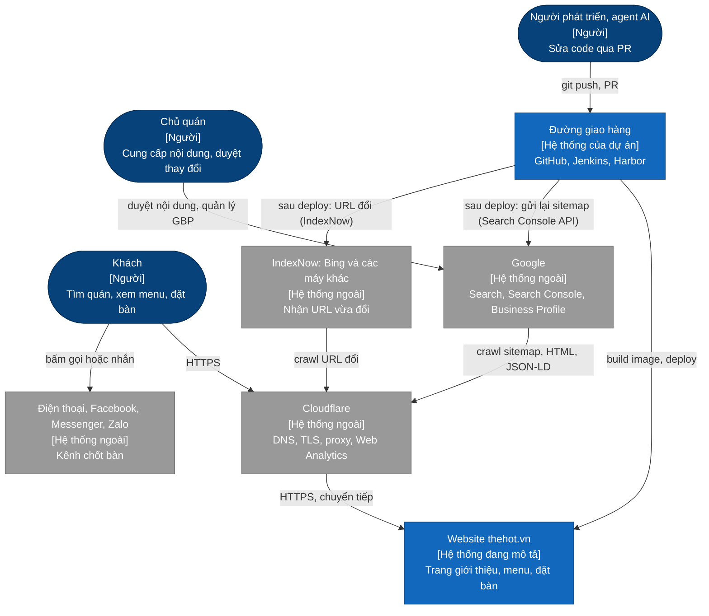
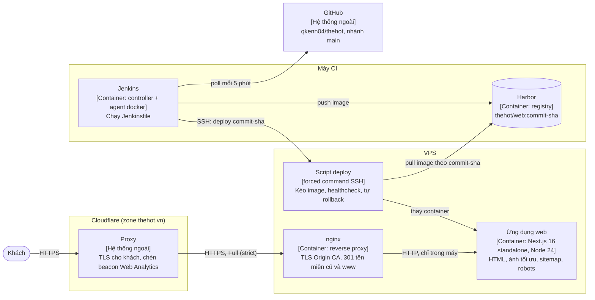
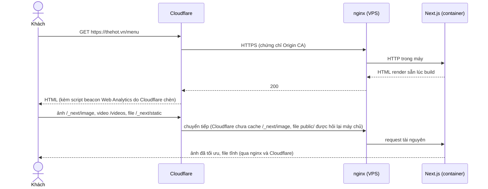
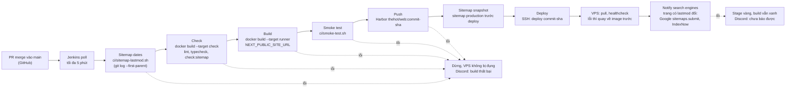

# Kiến trúc The Hot Beer Garden (thehot.vn)

> Trạng thái: Đang áp dụng · Cập nhật: 2026-10-18 · Liên quan: [Đặc tả sản phẩm](../product/spec.md), [Yêu cầu phi chức năng](../product/nfr.md), [Mô hình dữ liệu nội dung](data-model.md), [Sơ đồ](diagrams/README.md), [Mục lục ADR](../adr/README.md), [Triển khai](../ops/deployment.md), [Mô hình đe doạ](../security/threat-model.md)

Tính tới 2026-10-14. Repo công khai: tài liệu này chỉ mô tả hạ tầng ở mức đã thấy trong `Jenkinsfile`. Địa chỉ máy chủ, cổng nội bộ, đường dẫn trên máy chủ, cấu hình nginx và script deploy nằm ở repo riêng tư `qkenn04/infra-qkenn`.

## 1. Tóm tắt

| Câu hỏi | Trả lời |
|---|---|
| Có mấy tiến trình chạy lâu phục vụ khách? | Một container Next.js 16 (bản standalone, `node server.js`) trên một VPS, phía trước là nginx trên cùng VPS và Cloudflare. Jenkins và Harbor chạy trên một máy CI riêng, không phục vụ khách |
| Dữ liệu nằm ở đâu? | Không có cơ sở dữ liệu. Nội dung (tên, địa chỉ, giờ, menu, sự kiện, ảnh, video) nằm trong code và `public/`, được build vào image ([Mô hình dữ liệu nội dung](data-model.md)) |
| Người dùng đi vào từ đâu? | `https://thehot.vn` qua Cloudflare. `www.thehot.vn`, `thehot.k2-tech.dev`, `nokto.qkenn.cloud` chuyển hướng 301 về `https://thehot.vn`, giữ đường dẫn ([ADR 0002](../adr/0002-use-thehot-vn-as-primary-domain.md)) |
| Khi khách mở một trang thì sao? | Cloudflare chuyển request tới nginx, nginx tới container Next.js; HTML được render sẵn lúc build. Ảnh qua `/_next/image` được tối ưu lúc chạy; video và ảnh gốc phục vụ từ `public/` (luồng ở mục 4.1) |
| Khách đặt bàn thì sao? | Form `/reservation` chỉ chạy trong trình duyệt, không gửi dữ liệu; khách gọi hoặc nhắn quán qua link `tel:`, Facebook, Messenger, Zalo (mục 4.3) |
| Hỏng thành phần nào thì khách thấy gì? | VPS hoặc container ngừng: Cloudflare trả trang lỗi 5xx. Cloudflare sự cố: site không vào được. Máy CI tắt: site vẫn chạy, chỉ không deploy được |
| Deploy thế nào? | Merge vào `main` → Jenkins poll (tối đa 5 phút) → Sitemap dates → Check → Build → Smoke test → Push lên Harbor → Sitemap snapshot → Deploy qua SSH → Notify search engines ([Triển khai](../ops/deployment.md)) |

## 2. Sơ đồ ngữ cảnh (C4 mức 1)



## 3. Thành phần (C4 mức 2)



| Thành phần | Công nghệ | Trách nhiệm | Chạy ở đâu | Dữ liệu sở hữu | ADR |
|---|---|---|---|---|---|
| Cloudflare | Dịch vụ ngoài | DNS, TLS phía khách, proxy, Always Use HTTPS, Web Analytics (beacon tự chèn) | Cloudflare | Không | [0002](../adr/0002-use-thehot-vn-as-primary-domain.md), [0007](../adr/0007-use-umami-and-consent-gated-ga4.md) |
| nginx | nginx | TLS với chứng chỉ Cloudflare Origin CA; 301 tên miền cũ và `www`; chuyển tiếp tới container | VPS | Không | [0002](../adr/0002-use-thehot-vn-as-primary-domain.md), [0003](../adr/0003-allow-search-indexing.md) |
| Ứng dụng web | Next.js 16.3.5, React 19, Node 24 (`node:24.14.1-slim`), user `node` | Phục vụ 7 trang, `sitemap.xml`, `robots.txt`, `/_next/image`, file tĩnh trong `public/`; có Docker `HEALTHCHECK` | Container trên VPS, chỉ nghe trong máy | Nội dung build sẵn trong image | [0004](../adr/0004-automate-sitemap-from-page-config-and-git.md), [0005](../adr/0005-separate-search-titles-from-headings.md), [0006](../adr/0006-prioritize-lcp-with-fetchpriority.md) |
| Script deploy | Shell, Docker Compose | Kéo image theo commit SHA, đợi healthcheck, tự quay về image trước khi lỗi; giữ 3 image gần nhất | VPS (nguồn ở `qkenn04/infra-qkenn`) | Image đã kéo | — |
| Jenkins | Jenkins Pipeline, agent nhãn `docker` | Chạy `Jenkinsfile`: tính ngày sitemap, kiểm, build, smoke test, push, deploy; sau deploy báo máy tìm kiếm trang nào đổi ([ADR 0009](../adr/0009-notify-search-engines-after-deploy.md)); báo kết quả lên Discord | Máy CI (nguồn ở `qkenn04/infra-qkenn`) | Lịch sử build | — |
| Harbor | Harbor | Lưu image `thehot/web:<commit sha>` | Máy CI | Image | — |
| GitHub | Dịch vụ ngoài | Nguồn code, PR, review | GitHub | Lịch sử git (cũng là nguồn ngày `lastmod`) | [0004](../adr/0004-automate-sitemap-from-page-config-and-git.md) |
| Google Search Console API, IndexNow | Dịch vụ ngoài | Nhận tin "sitemap đã đổi" (Google, `sitemaps.submit`) và danh sách URL trang vừa đổi (IndexNow: Bing, Yandex, Seznam, Naver…). Chỉ Jenkins gọi, chỉ gửi URL công khai, không có dữ liệu khách | Google, IndexNow | Không | [0009](../adr/0009-notify-search-engines-after-deploy.md) |
| Umami | Umami tự cài (hạ tầng ở repo riêng) | Nhận lượt xem và sự kiện từ trình duyệt khách, không cookie. Site chỉ tải tracker khi build có Website ID (Website ID đặt trong `Jenkinsfile` từ 2026-10-15) | Tên miền con của `thehot.vn` | Số liệu truy cập | [0007](../adr/0007-use-umami-and-consent-gated-ga4.md) |

### 3.1 Ranh giới giữa các phần

- **Ứng dụng không gọi dịch vụ nào lúc chạy:** không cơ sở dữ liệu, không API, không gửi form. Liên hệ đều là link ra ngoài (`tel:`, `facebook.com`, `m.me`, `zalo.me`). Kiểm bằng review; AC-06 ở [đặc tả](../product/spec.md#7-tiêu-chí-nghiệm-thu-cấp-sản-phẩm).
- **Số liệu truy cập đi thẳng từ trình duyệt khách tới Umami** (khi build có Website ID), không qua container. Sự kiện tự định nghĩa chỉ đi qua `track()` trong `src/lib/analytics.ts`, với danh sách thuộc tính cho phép; không bao giờ có dữ liệu khách nhập ([spec 004](../specs/004-analytics/spec.md)).
- **Container chỉ nhận traffic từ nginx;** nginx chỉ nhận traffic từ Cloudflare. Cấu hình và kiểm ở `qkenn04/infra-qkenn`.
- **Jenkins không có quyền shell trên VPS:** khoá deploy chỉ chạy được một lệnh deploy định sẵn, host key được ghim (`StrictHostKeyChecking=yes` trong `Jenkinsfile`). VPS tự kéo image từ Harbor.
- **Lỗi trước stage Deploy không chạm VPS.** Thông báo Discord phân biệt "Build thất bại, VPS không bị đụng" với "Deploy thất bại, VPS đã tự quay về bản cũ".
- **Báo máy tìm kiếm không bao giờ làm hỏng deploy.** Stage Notify search engines chạy sau khi site mới đã lên; lỗi ở đó (thiếu khoá, API lỗi) chỉ làm stage vàng. Script chỉ đọc sitemap công khai, không cần quyền gì trên VPS.
- **Thư mục `docs/`, `ci/`, `scripts/` không vào Docker build context** (`.dockerignore`). Script phải chạy trong bước Check thì đặt ngoài các thư mục đó (vì vậy `seo/check-sitemap-pages.mjs` nằm ở `seo/`). `.git` cũng bị loại, nên mọi thứ cần lịch sử git chạy trên agent Jenkins trước `docker build` ([ADR 0004](../adr/0004-automate-sitemap-from-page-config-and-git.md)).
- **Dữ liệu mà code phía server cần đọc không nằm trong file `"use client"`** (giá trị export từ module client là client reference). Ví dụ: `menuPages.ts` tách khỏi `MenuBook.tsx` để sitemap đọc được. Chi tiết: [Front-end](../dev/frontend.md).

## 4. Các luồng chính

### 4.1 Khách mở một trang



Khi hỏng: container không trả lời thì nginx trả 502 và khách thấy trang lỗi; trong lúc deploy đổi container có thể có vài giây 502 (ước lượng thô). Cache: `/_next/static` cache dài hạn; `/_next/image` và file trong `public/` chưa được Cloudflare cache tốt (việc của spec hiệu năng, xem [dev/perf.md](../dev/perf.md)).

### 4.2 Đưa một thay đổi lên production



Pipeline không chạy song song (`disableConcurrentBuilds`), timeout 30 phút. Chi tiết từng stage, cách kiểm sau deploy và rollback: [Triển khai](../ops/deployment.md).

### 4.3 Khách đặt bàn

1. Khách bấm "Đặt bàn" (nút nổi hoặc menu) → `/reservation`.
2. Form 3 bước (ngày và giờ, tên và liên hệ, kiểm tra) chạy hoàn toàn trong trình duyệt; dữ liệu chỉ ở state React và mất khi tải lại trang.
3. Bước cuối báo rõ thông tin chưa được gửi, đưa nút Gọi và Nhắn Facebook. Việc chốt bàn xảy ra ngoài hệ thống, giữa khách và quán.

## 5. Dữ liệu (tóm tắt)

- Nguồn sự thật của thông tin quán (tên, địa chỉ, hotline, giờ, link mạng xã hội) là `src/components/sites/nokto/site.ts`. JSON-LD, footer, trang `/terms` và mô tả trang đọc từ đó (còn vài chỗ gõ lại, xem bất biến I-01).
- Nội dung trang nằm trong các module dữ liệu (`content.ts`, `menu/data.ts`, `menuPages.ts`, `videos.ts`); ảnh và video trong `public/`.
- Danh sách trang của sitemap: `seo/sitemap-pages.json`; tiêu đề và mô tả cho tìm kiếm: `src/seo/page-meta.ts`.
- Không có dữ liệu cần sao lưu ngoài git và image trong registry.

Chi tiết và bất biến: [Mô hình dữ liệu nội dung](data-model.md).

## 6. Môi trường

| Môi trường | Mục đích | Chạy ở đâu | Dữ liệu | Tên riêng |
|---|---|---|---|---|
| dev | Phát triển | Máy dev: `npm run dev` (`http://localhost:3000`), hoặc dịch vụ `dev` trong `docker-compose.yml` | Nội dung trong repo | `NEXT_PUBLIC_SITE_URL` không đặt nên URL tuyệt đối là `http://localhost:3000`; sitemap không có `<lastmod>` nếu chưa chạy `ci/sitemap-lastmod.sh` |
| CI | Kiểm và build mỗi commit trên `main` | Agent Jenkins nhãn `docker` trên máy CI | Như trên | Container smoke test tên `thehot-smoke-$BUILD_NUMBER-$$`, xoá sau khi chạy |
| prod | Khách thật | VPS sau Cloudflare | Như trên | `https://thehot.vn` |

Không có staging: image đã qua smoke test được deploy thẳng lên production. Nhánh tính năng không được build tự động; PR chỉ được kiểm trên máy người làm (`npm run check`) trước khi merge.

## 7. Triển khai

Mỗi commit trên `main` được build một lần thành image gắn nhãn commit SHA, kiểm bằng smoke test, đẩy lên Harbor, rồi Jenkins gọi lệnh deploy trên VPS qua SSH. Script trên VPS kéo đúng image đó, đợi healthcheck và tự quay về image trước nếu bản mới không khoẻ. Chi tiết: [Triển khai](../ops/deployment.md); chính sách và khoảng cách so với chính sách: [CI/CD core](../ops/ci-cd-core.md).

## 8. Bảo mật (tóm tắt)

Site không có tài khoản, không nhận dữ liệu từ khách, không có bí mật lúc chạy. Bề mặt chính là đường giao hàng (Jenkins, Harbor, khoá deploy, khoá service account cho Search Console) và các script bên thứ ba chạy trên trang (beacon Cloudflare hiện tại; Umami và GA4 theo kế hoạch). Header bảo mật (HSTS, CSP, X-Frame-Options) còn thiếu. Chi tiết: [Mô hình đe doạ](../security/threat-model.md).

## 9. Cấu trúc thư mục repo

```text
thehot/
├── src/app/                 route Next.js: 7 trang, layout (metadata, JSON-LD, màn hình chờ), sitemap.ts, robots.ts, ảnh OG
├── src/components/sites/    giao diện và dữ liệu nội dung: nokto/ (khung dựng từ template) và the-hot/ (phần riêng của quán)
├── src/components/analytics/, src/lib/analytics.ts   tracker Umami, listener click, track() (spec 004)
├── src/seo/                 page-meta.ts (tiêu đề, mô tả), sitemap-images.ts (sitemap ảnh)
├── src/generated/           sitemap-lastmod.json do CI sinh (git-ignored)
├── seo/                     sitemap-pages.json (danh sách trang), check-sitemap-pages.mjs (guard chạy trong bước Check)
├── public/                  ảnh, video, font; sites/the-hot-beer-garden/ (của quán), sites/nokto/ (của template); <khoá>.txt (khoá IndexNow, công khai)
├── ci/                      sitemap-lastmod.sh, smoke-test.sh, notify-search.sh (chạy trên agent Jenkins)
├── Dockerfile, Jenkinsfile  build nhiều stage (dependencies, check, builder, runner) và pipeline
├── docs/                    tài liệu (bắt đầu từ docs/README.md)
└── scripts/                 check-links.py (kiểm link tài liệu), script tải tài sản template
```

Cấu trúc bên trong `src/` và luật import: [Front-end](../dev/frontend.md).

## 10. Công nghệ và phiên bản

| Thành phần | Công nghệ | Phiên bản | Ghim bằng | ADR |
|---|---|---|---|---|
| Runtime | Node.js | 24.14.1 (`node:24.14.1-slim`); máy dev yêu cầu ≥ 24 | `ARG NODE_VERSION` trong `Dockerfile` (tag, không digest), `.nvmrc`, `engines` | — |
| Framework | Next.js, React | 16.3.5, 19.2.4 | `package.json`, `package-lock.json` | — |
| Ngôn ngữ, style | TypeScript 5 (strict), Tailwind CSS 4 | xem `package-lock.json` | `package-lock.json` | — |
| Hiệu ứng | `motion` 14, `lenis` 1.3 (cuộn mượt) | xem `package-lock.json` | `package-lock.json` | — |
| Lint | ESLint 9, `eslint-config-next` 16.3.5 | | `package-lock.json` | — |

## 11. Kiểm thử theo tầng

Không có unit test. Lớp bảo vệ là lint, typecheck, guard sitemap (bước Check), build, và smoke test trên chính image sẽ deploy. Kiểm hiệu năng, SEO và giao diện là kiểm tay có ghi lại. Chi tiết và lệnh: [Kiểm thử](../dev/testing.md).

## 12. Ràng buộc và đánh đổi đã biết

- **Một VPS là điểm lỗi chung.** Không có bản dự phòng; chấp nhận cho một site giới thiệu quán. Ngưỡng sẵn sàng chưa chốt (AVAIL-01 ở [yêu cầu phi chức năng](../product/nfr.md)).
- **Không có staging và deploy tự động sau merge.** Một PR đã merge lên production sau khoảng 10 phút (ước lượng thô); đường lùi là revert và deploy lại, hoặc quay image trên VPS.
- **Deploy theo tag commit SHA, chưa theo digest;** pipeline chưa ký image hay tạo SBOM, chưa chặn theo kết quả quét lỗ hổng ([CI/CD core, mục 0](../ops/ci-cd-core.md#0-áp-dụng-ở-dự-án-này)).
- **Video nằm thẳng trong git** (từ PR #16 video hero là hai bản 26,8 MB và 31,5 MB; bản 83,7 MB cũ vẫn nằm trong lịch sử git), làm repo và image nặng ([ADR 0008](../adr/0008-compress-hero-video-without-trimming.md)).
- **Còn dùng tài sản của template NOKTO:** ảnh nền `hero-backdrop.jpg` trên mọi trang và vài SVG trang trí ([ADR 0003](../adr/0003-allow-search-indexing.md)).
- **Cache ảnh của Next.js nằm trong container** nên mất sau mỗi lần deploy; Cloudflare chưa cache `/_next/image` (spec hiệu năng).
- **Máy CI là một máy WSL;** khởi động lại không sạch từng làm hỏng cache git của Jenkins ([runbook 001](../ops/runbooks/001-jenkins-git-cache-corrupted.md)).

## 13. Câu hỏi mở

- [CẦN XÁC NHẬN: chế độ SSL/TLS của zone `thehot.vn` trên Cloudflare đã là Full (strict) chưa. Máy chủ dùng chứng chỉ Origin CA nên Full (strict) là chế độ đích; kế hoạch SEO ngày 2026-10-14 còn để mở việc này]
- [CẦN XÁC NHẬN: có monitor uptime nào theo dõi `https://thehot.vn` từ bên ngoài không]
