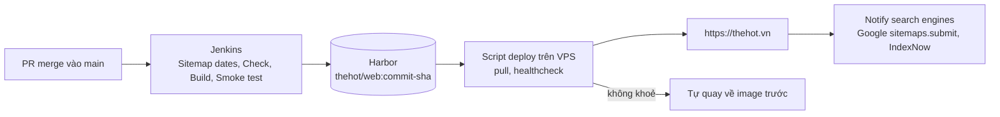

# Triển khai

> Trạng thái: Đang áp dụng · Cập nhật: 2026-10-18 · Liên quan: [ADR 0009](../adr/0009-notify-search-engines-after-deploy.md), [Kiến trúc](../architecture/ARCHITECTURE.md), [Cấu hình](../dev/configuration.md), [Kiểm thử](../dev/testing.md), [Runbook](runbooks/README.md), [Postmortem](postmortems/README.md), [CI/CD core](ci-cd-core.md)

Code đi từ một PR tới https://thehot.vn thế nào, kiểm sau deploy ra sao, và lùi lại bằng cách nào. Repo công khai: file này mô tả ở mức `Jenkinsfile` đã thể hiện. Script deploy trên VPS, compose stack, cấu hình nginx, cài đặt Jenkins và Harbor, quy trình quản trị nằm ở repo riêng `qkenn04/infra-qkenn`. Tính tới 2026-10-14.

Ngày 2026-10-18, repo (`qkenn04/nokto-clone-v2` → `qkenn04/thehot`) và hạ tầng của site (project Harbor và image `thehot/web`, stack trên VPS, tài khoản robot mà Jenkins dùng để push) đổi tên từ `nokto` sang `thehot`; tên miền không đổi. Thư mục `src/components/sites/nokto/` và `public/sites/nokto/` cố ý giữ tên cũ vì là phần dựng từ template NOKTO.

## 0. Tóm tắt một trang

| Câu hỏi | Trả lời |
|---|---|
| Artifact là gì | Image Docker `thehot/web:<commit sha đầy đủ>` trong Harbor, gắn nhãn OCI `org.opencontainers.image.revision` (commit) và `source` (URL repo) |
| Ai kích hoạt deploy | Merge (hoặc push) vào `main`. Jenkins poll GitHub mỗi 5 phút; không có bước duyệt tay |
| Chạy ở đâu | Một container trên VPS, sau nginx và Cloudflare ([Kiến trúc](../architecture/ARCHITECTURE.md)) |
| Deploy mất bao lâu | Khoảng 10 phút từ lúc merge tới khi lên production (ước lượng thô: poll tối đa 5 phút cộng pipeline khoảng 7 phút) |
| Lùi lại thế nào | Mục 7 |
| Bí mật nằm ở đâu | Jenkins Credentials; [Cấu hình, mục 5](../dev/configuration.md#5-bí-mật-nơi-giữ-xoay-vòng-thu-hồi) |
| Biết kết quả ở đâu | Thông báo Discord sau mỗi build; lịch sử build trong Jenkins |
| Máy tìm kiếm biết trang đổi thế nào | Tự động sau deploy: gửi lại sitemap cho Google, gửi URL đổi qua IndexNow (mục 5, [ADR 0009](../adr/0009-notify-search-engines-after-deploy.md)) |

## 1. Bức tranh tổng thể

Sơ đồ đầy đủ (kèm đường lỗi): [Kiến trúc, mục 4.2](../architecture/ARCHITECTURE.md#42-đưa-một-thay-đổi-lên-production).



## 2. Thành phần chạy ở đâu

| Thành phần | Chạy ở đâu | Quản lý bằng | Log ở đâu |
|---|---|---|---|
| Ứng dụng web | Container trên VPS | Compose stack và script deploy (repo infra) | Log container trên VPS |
| nginx | VPS | Cấu hình trong repo infra | Log nginx trên VPS |
| Jenkins, Harbor | Máy CI | Cấu hình trong repo infra (`ci/`) | Lịch sử build trong Jenkins |

## 3. Môi trường

| Môi trường | Kích hoạt | Dữ liệu | Ai truy cập |
|---|---|---|---|
| dev | Tay, trên máy (`npm run dev` hoặc `docker compose up`) | Nội dung trong repo | Người phát triển |
| prod | Tự động sau khi commit lên `main` | Nội dung trong repo | Khách |

Không có staging. Smoke test chạy trên chính image sẽ deploy, ngay trên máy CI, là lớp kiểm cuối trước production.

## 4. Build và artifact

- Mỗi commit trên `main` được build **một lần** thành image `runner`; image đã qua smoke test là image được push và deploy.
- `docker build --pull` lấy lại image nền `node:24.14.1-slim` mỗi lần build; phụ thuộc npm ghim bằng `package-lock.json` (`npm ci`).
- `NEXT_PUBLIC_SITE_URL=https://thehot.vn` được truyền lúc build; `NEXT_PUBLIC_UMAMI_WEBSITE_ID` và `NEXT_PUBLIC_UMAMI_SRC` cũng vậy (từ `UMAMI_WEBSITE_ID`, `UMAMI_SRC` trong `Jenkinsfile`; ID để trống thì image không tải tracker Umami) ([Cấu hình](../dev/configuration.md)).
- Deploy theo **tag commit SHA**, chưa theo digest; pipeline chưa ký image, chưa tạo SBOM ([CI/CD core, mục 0](ci-cd-core.md#0-áp-dụng-ở-dự-án-này)).
- Sau mỗi build, Jenkins xoá image khỏi Docker của máy CI (đã nằm trong Harbor) và dọn build cache cũ hơn 7 ngày.

## 5. CI

Một pipeline duy nhất trong `Jenkinsfile`, chạy trên agent nhãn `docker`. Không chạy song song (`disableConcurrentBuilds`), timeout 30 phút, giữ lịch sử 20 build.

| Stage | Làm gì | Hỏng thì |
|---|---|---|
| Existing image | Kéo `$IMAGE:$GIT_COMMIT` từ Harbor bằng robot của stage Push, đăng xuất ngay. Kéo được (commit đã build trước đó): bỏ qua Sitemap dates, Check, Build, Push; Smoke test chạy trên image vừa kéo, rồi deploy như thường. Trước đó kiểm Jenkins có đặt địa chỉ registry và VPS (`QKENN_HARBOR_REGISTRY`, `QKENN_DEPLOY_HOST`, đặt bằng JCasC ở repo infra); `Jenkinsfile` không còn giá trị mặc định nào cho hai biến này | Thiếu một trong hai biến: dừng ngay, VPS không bị đụng. Kéo lỗi: không dừng, build như commit mới |
| Sitemap dates | `bash ci/sitemap-lastmod.sh`: tính `lastmod` từ lịch sử git, ghi `src/generated/sitemap-lastmod.json` ([ADR 0004](../adr/0004-automate-sitemap-from-page-config-and-git.md)) | Dừng; VPS không bị đụng |
| Check | `docker build --target check`: lint, typecheck, `check:sitemap` | Như trên |
| Build | `docker build --target runner --pull` với `NEXT_PUBLIC_SITE_URL`, `NEXT_PUBLIC_UMAMI_WEBSITE_ID`, `NEXT_PUBLIC_UMAMI_SRC` và nhãn OCI | Như trên |
| Smoke test | `ci/smoke-test.sh "$IMAGE:$GIT_COMMIT" "$SITE_URL" "$UMAMI_WEBSITE_ID"` ([Kiểm thử, mục 3](../dev/testing.md#3-smoke-test-kiểm-gì)) | Như trên |
| Push | Đăng nhập Harbor bằng tài khoản chỉ dùng để push, push image, đăng xuất | Như trên |
| Sitemap snapshot | `bash ci/notify-search.sh snapshot`: đọc `/sitemap.xml` đang chạy trên production, giữ URL trang và `<lastmod>` để so sau deploy | Không bao giờ dừng build; không đọc được thì sau deploy coi mọi trang là đã đổi |
| Deploy | SSH tới VPS bằng khoá chỉ chạy được lệnh deploy, host key ghim: `deploy <commit sha>` | Script trên VPS tự quay về image trước; Discord báo "Deploy THẤT BẠI — VPS đã tự quay về bản cũ" |
| Notify search engines | `bash ci/notify-search.sh notify` (tối đa 5 phút): đợi sitemap production khớp ngày của build này, so với bản chụp; có trang đổi thì gửi lại sitemap cho Google (Search Console API) và gửi URL đổi qua IndexNow ([ADR 0009](../adr/0009-notify-search-engines-after-deploy.md)) | Chỉ stage này vàng (`UNSTABLE`), build vẫn xanh; Discord báo "Deploy thành công … chưa báo được công cụ tìm kiếm" |

Thông báo Discord: thành công; thành công nhưng chưa báo được máy tìm kiếm (stage Notify search engines vàng); "Build THẤT BẠI — VPS không bị đụng" khi hỏng trước stage Deploy; "Deploy THẤT BẠI" khi hỏng ở stage Deploy.

## 6. Deploy

### 6.1 Trình tự

1. PR được review và merge vào `main` trên GitHub.
2. Trong vòng 5 phút, Jenkins thấy commit mới và chạy pipeline (mục 5).
3. Stage Sitemap snapshot chụp sitemap đang chạy; stage Deploy gọi lệnh deploy trên VPS với commit SHA.
4. Script deploy trên VPS kéo image `thehot/web:<sha>` từ Harbor, thay container, đợi healthcheck (`HEALTHCHECK` trong `Dockerfile` gọi `/`).
5. Container mới khoẻ: xong; VPS giữ 3 image gần nhất để lùi tay. Không khoẻ: script tự chạy lại image trước và báo lỗi về Jenkins.
6. Stage Notify search engines báo Google và IndexNow những trang có `<lastmod>` đổi (không đổi trang nào thì không gửi gì).
7. Kiểm sau deploy (mục 6.3).

### 6.2 Các bước và cách hỏng

| Bước | Hỏng thì | Hệ thống làm gì | Người làm gì |
|---|---|---|---|
| Checkout trên Jenkins | Lỗi git (ví dụ object rỗng sau khi máy CI tắt đột ngột) | Build dừng trước mọi stage; VPS không bị đụng | [Runbook 001](runbooks/001-jenkins-git-cache-corrupted.md) |
| Sitemap dates, Check, Build, Smoke test | Lỗi lint, kiểu, sitemap, build hoặc smoke test | Dừng; VPS không bị đụng | Sửa bằng PR mới |
| Push | Harbor không chạy, sai quyền | Dừng; VPS không bị đụng | Kiểm Harbor trên máy CI (repo infra) |
| Deploy, healthcheck | Container mới không khoẻ | Tự quay về image trước | Xem log container (repo infra), sửa bằng PR |
| Notify search engines | Thiếu khoá Google, API Google hoặc IndexNow lỗi, sitemap production chưa khớp build sau khoảng 1 phút | Stage vàng, build vẫn xanh, site không bị ảnh hưởng; lần deploy sau chỉ gửi trang đổi ở lần đó | Đọc log stage (mỗi lỗi có một dòng `notify-search: WARNING`); khoá Google: repo infra; trang cần gấp thì Request indexing tay (mục 6.3) |

### 6.3 Kiểm sau deploy

Từ máy cá nhân, không từ VPS:

```bash
# Trang chủ trả 200, không có X-Robots-Tag
curl -sI https://thehot.vn/ | head -n 20

# Sitemap có đủ trang và ngày mới
curl -s https://thehot.vn/sitemap.xml | grep -o '<loc>[^<]*</loc>\|<lastmod>[^<]*</lastmod>'

# Tên miền cũ vẫn chuyển hướng 301, giữ đường dẫn
curl -sI https://thehot.k2-tech.dev/menu | grep -i '^location'
```

- Nếu PR đổi trang hoặc nội dung: không cần làm gì với máy tìm kiếm. Stage Notify search engines đã gửi lại sitemap cho Google và gửi URL đổi qua IndexNow; log stage ghi trang nào được gửi và kết quả. Kiểm khi cần: Search Console → Sitemaps xem "Last read"; Bing Webmaster Tools → IndexNow xem URL nhận được.
- Request indexing tay (Search Console → URL Inspection) chỉ còn cho trang hoàn toàn mới cần lên nhanh, bản sửa gấp, hoặc khi stage Notify search engines vàng.
- Nếu PR nhằm vào hiệu năng: PageSpeed Mobile 3 lần, ghi vào [dev/perf.md](../dev/perf.md).
- Nếu PR đổi tiêu đề, mô tả, ảnh chia sẻ: Facebook Sharing Debugger → Scrape Again.
- Nếu PR thay nội dung một ảnh hoặc video mà giữ nguyên tên tệp: purge URL trên Cloudflare (mục 6.4).

### 6.4 Thay ảnh hoặc video giữ nguyên tên

Từ 2026-10-15, tệp trong `public/` (`/videos`, `/images`, `/sites`) được Cloudflare và trình duyệt giữ 7 ngày (`Cache-Control: public, max-age=604800, stale-while-revalidate=86400`, đặt ở reverse proxy theo `qkenn04/infra-qkenn`); ảnh đã tối ưu `/_next/image` cũng 7 ngày (`images.minimumCacheTTL` và Cache Rule "Cache Next images" trên Cloudflare). Vì vậy thay nội dung một tệp mà **giữ nguyên tên** thì sau khi deploy, Cloudflare vẫn có thể trả bản cũ tới 7 ngày.

Cách nên làm: đổi tên tệp khi đổi nội dung (ví dụ `main.v2.mp4`) và sửa chỗ dùng; URL mới không dính bản cũ trong cache.

Lỡ giữ tên, làm sau khi Jenkins deploy xong (máy cá nhân, tài khoản có quyền vào zone):

1. Cloudflare dashboard → zone `thehot.vn` → **Caching → Purge Cache → Custom Purge** → chọn URL.
2. Dán URL đầy đủ của từng tệp đã thay, ví dụ `https://thehot.vn/sites/the-hot-beer-garden/images/logo.png`, rồi Purge.
3. Ảnh hiển thị qua `next/image`: purge thêm các URL `https://thehot.vn/_next/image?url=…&w=…&q=…` của ảnh đó (lấy từ DevTools → Network khi mở trang trên điện thoại và máy tính). Nhiều URL quá thì dùng Purge Everything: chỉ làm Cloudflare lấy lại từ máy chủ, không mất dữ liệu (HTML vốn không được cache).
4. Kiểm: `curl -sI <URL>` hai lần; lần hai `cf-cache-status: HIT`, và mở URL trong cửa sổ ẩn danh thấy bản mới.

Giới hạn:

- Purge không xoá được bản đã nằm trong trình duyệt của khách: ai đã tải có thể thấy bản cũ tới 7 ngày. Cần mọi người thấy ngay thì phải đổi tên tệp.
- Bộ nhớ ảnh đã tối ưu của Next.js nằm trong container và hiện mất sau mỗi deploy, nên không cần xoá. Nếu sau này giữ `.next/cache` qua các lần deploy ([003 phần D](../specs/003-performance/spec.md#phần-d-ảnh-một-phần-xong)) thì phải xoá cả bộ nhớ đó.

## 7. Rollback

| Kiểu | Khi nào | Cách làm | Thời gian |
|---|---|---|---|
| Tự động khi deploy | Container mới không qua healthcheck | Script deploy tự chạy lại image trước | Vài giây đến vài phút (ước lượng thô) |
| Revert PR | Bản mới chạy được nhưng sai (giao diện, nội dung, SEO) | Trên GitHub: Revert PR → merge PR revert; Jenkins build và deploy như mọi commit | Khoảng 10 phút (ước lượng thô) |
| Lùi image tay trên VPS | Cần lùi ngay, không chờ pipeline, hoặc máy CI đang hỏng | VPS giữ 3 image gần nhất; thao tác theo tài liệu của stack trong `qkenn04/infra-qkenn` | Vài phút (ước lượng thô) |

Site không có cơ sở dữ liệu hay migration nên lùi image không cần khôi phục dữ liệu. Sau khi lùi tay trên VPS, commit trên `main` vẫn là bản lỗi: phải revert trên GitHub, nếu không lần deploy tiếp theo sẽ đưa bản lỗi trở lại.

## 8. Cài đặt lần đầu

Dựng máy CI (Jenkins, Harbor), job Jenkins, stack trên VPS, vhost nginx và khoá deploy: theo `qkenn04/infra-qkenn` (`ci/`, `stacks/`). Không có bước cài đặt nào nằm trong repo này.

## 9. Điều kiện vận hành

| Điều kiện | Trạng thái (2026-10-14) |
|---|---|
| Deploy tự động sau merge chạy thật | Có (build #16 deploy `90f1882`) |
| Tự rollback khi healthcheck lỗi đã được thử | `[CẦN XÁC NHẬN: đã diễn tập chưa]` |
| Lùi image tay trên VPS đã được diễn tập | `[CẦN XÁC NHẬN: đã diễn tập chưa]` |

## 10. Câu hỏi mở

- [CẦN XÁC NHẬN: có muốn thêm bước duyệt tay trước stage Deploy không]
- [CẦN XÁC NHẬN: có build và kiểm PR trước khi merge (status check trên GitHub) không]
