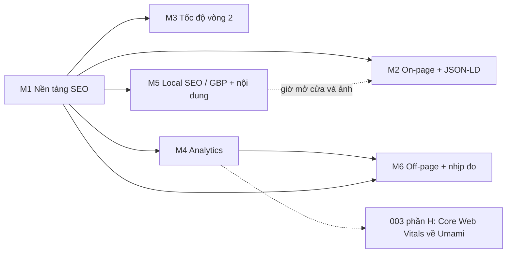

# Lộ trình

> Trạng thái: Đang áp dụng · Cập nhật: 2026-10-15 · Liên quan: [Bản đồ tài liệu](../README.md), [Việc sắp làm](tasks.md), [Tiến độ](progress.md), [Mục lục spec](../specs/README.md), [Mục lục ADR](../adr/README.md)

Lộ trình đưa https://thehot.vn (The Hot Beer Garden Đà Lạt) lên Google và giữ nó nhanh, đo được: nền tảng kỹ thuật, nội dung trên trang, tốc độ, đo lường, rồi các việc ngoài website do chủ quán làm.

Đơn vị ước lượng: ngày công dev (ước lượng thô). Thời gian của chủ quán ghi riêng. Người làm: **Chủ quán** (chủ quán hoặc người quản lý) và **Dev** (code, CI; mọi thay đổi đi qua PR).

## 1. Bảng tổng

| Mốc | Nội dung | Spec | ADR | Ước lượng thô | Phụ thuộc |
|---|---|---|---|---|---|
| [M1](#m1-nền-tảng-seo) | Nền tảng SEO: tên miền, cho phép index, Search Console, Bing, Cloudflare, sitemap, tiêu đề, ảnh chia sẻ, tốc độ nhanh | `001`, `002` (A, B), `003` (A) | 0002–0006 | không ước lượng trước | — |
| [M2](#m2-on-page-và-dữ-liệu-có-cấu-trúc) | On-page và dữ liệu có cấu trúc: JSON-LD, alt, ảnh, chữ giới thiệu và hỏi đáp | `002` (C–F), `001` (PR 2) | 0005 | chưa ước lượng (chờ câu trả lời và ảnh) | M1, chủ quán |
| [M3](#m3-tốc-độ-vòng-2) | Tốc độ vòng 2: video hero, cache, ảnh, màn hình chờ, font | `003` (B–G) | 0006, 0008 | 1,5–2 ngày công (chưa tính font) | M1 |
| [M4](#m4-analytics) | Analytics: Umami, GA4 sau đồng ý, banner | `004` | 0007 | 2–2,5 ngày công phía web; chủ quán khoảng 1,5 giờ | M1, hạ tầng Umami |
| [M5](#m5-local-seo-google-business-profile-và-nội-dung) | Local SEO: Google Business Profile, đánh giá, trích dẫn, nội dung mới | trang sự kiện: spec mới khi làm | — | liên tục, chủ yếu chủ quán | M1 |
| [M6](#m6-off-page-và-nhịp-đo-lường) | Off-page và nhịp đo lường | — | — | liên tục | M1; M4 cho số analytics |

Số ADR tra ở [mục lục ADR](../adr/README.md).

## 2. Thứ tự và phụ thuộc

Vì sao thứ tự này:

- M1 trước: không được index, không có sitemap đúng thì mọi việc khác không có tác dụng. Phần lớn M1 xong ngày 2026-10-14.
- M2, M3, M4 làm song song được; mỗi cái bị chặn bởi một thứ khác nhau (câu trả lời và ảnh của chủ quán; `ffmpeg` và duyệt chất lượng; hạ tầng Umami và GA4 property). Dev làm cái nào gỡ chặn trước.
- M5 là phần quan trọng nhất cho từ khoá "quán nhậu Đà Lạt": ba quán trên Google Maps luôn nằm trên mọi website. Chủ quán làm song song ngay từ bây giờ, không chờ dev.
- M6 cần số liệu (Search Console có ngay; analytics sau M4).

## 3. Các mốc

### M1 Nền tảng SEO

**Trạng thái:** gần xong, 2026-10-14; còn các ô chưa tick dưới đây ([tiến độ](progress.md#theo-mốc)).

**Mục tiêu.** Site thật ở tên miền chính, được phép index, Google và Bing biết mọi trang, và các chỉ số cơ bản không có lỗi rõ ràng.

**Phạm vi.**

1. Tên miền chính `thehot.vn`; `thehot.k2-tech.dev` và `nokto.qkenn.cloud` chuyển hướng 301 giữ đường dẫn, giữ lâu dài (ADR 0002). Hai tên miền cũ chưa từng được index, nên không cần "Change of Address".
2. Cho phép index: bỏ `X-Robots-Tag: noindex`, thẻ `robots` = `index, follow` (ADR 0003).
3. Google Search Console: property dạng Domain `thehot.vn` (gom http, https, www), xác minh bằng bản ghi DNS TXT; gửi sitemap; Request indexing cho `/`, `/menu`, `/menu/list`, `/about`, `/reservation`; Test live URL tải được, được phép index.
4. Bing Webmaster Tools: Import from Google Search Console.
5. Cloudflare zone `thehot.vn`: CNAME `www` (proxied) → `www.thehot.vn` 301 về `https://thehot.vn` giữ đường dẫn; Always Use HTTPS; không chặn bot hợp lệ; SSL/TLS Full (strict).
6. Sitemap tự động ([001](../specs/001-sitemap-automation/spec.md), ADR 0004).
7. Tiêu đề, mô tả, ảnh chia sẻ ([002](../specs/002-onpage-seo/spec.md) phần A, B; ADR 0005).
8. Tốc độ nhanh không đổi giao diện: ưu tiên ảnh LCP, logo đúng kích thước ([003](../specs/003-performance/spec.md) phần A; ADR 0006).

**Sản phẩm bàn giao.** Production ở commit `90f1882` (Jenkins build #16); Search Console và Bing có property; sitemap 6 trang.

**Điều kiện xong.**

- [x] `https://thehot.vn` phục vụ site; tên miền cũ 301 giữ đường dẫn · `7af5058`, Jenkins build #10
- [x] Không có `X-Robots-Tag: noindex`; thẻ `robots` là `index, follow` trên 7 trang
- [x] `http://` → `https://` 301; `www.thehot.vn` → `https://thehot.vn` 301 giữ đường dẫn · kiểm bằng `curl` 2026-10-14
- [x] Search Console: Domain property xác minh, sitemap đã gửi, Request indexing 5 URL, Test live URL đạt · chủ quán, 2026-10-14
- [x] Bing Webmaster Tools đã import từ Search Console · chủ quán, 2026-10-14
- [x] Sitemap 6 trang, mỗi trang có `<lastmod>` và ảnh · PR #3, build #11
- [x] Tiêu đề, mô tả, ảnh chia sẻ trên production · PR #5, PR #6, build #16
- [x] Ưu tiên LCP và logo trên production · PR #4, build #16
- [ ] SSL/TLS **Full (strict)** trong Cloudflare: chủ quán xác nhận (ảnh chụp màn hình); không kiểm được từ bên ngoài
- [x] Request indexing cho `/terms` (trang mới vào sitemap) · không cần nữa: `/terms` đã "Submitted and indexed" (URL Inspection API, 2026-10-15)
- [x] Search Console → Sitemaps báo *Success*, 6 trang được khám phá · `sitemaps.get` 2026-10-15: 6 URL trang, 37 ảnh, 0 lỗi
- [ ] PageSpeed Mobile đo lại sau build #16, ghi vào [tiến độ](progress.md#đo-lường)

**Ước lượng.** Không ước lượng trước; làm trong ngày 2026-10-14.

**Phụ thuộc.** Quyền vào Cloudflare zone và tài khoản Google của quán.

**Spec và ADR.** 001, 002 (A, B), 003 (A); ADR 0002–0006.

**Rủi ro chính.** Thông tin trên site và Google Maps lệch nhau (giờ mở cửa): xử lý ở M5.

**Ngoài phạm vi mốc.** JSON-LD đầy đủ, nội dung mới, analytics.

**Ghi lại gì.** Ngày từng bước trong Search Console; số build và commit; số đo PageSpeed trước và sau.

### M2 On-page và dữ liệu có cấu trúc

**Trạng thái:** đang làm từ 2026-10-15: nhãn sự kiện 16/10, 17/10 đã gỡ (PR #8); JSON-LD đợt 1 và `/favicon.ico` lên production (PR #10, Jenkins build #20), Google đã đọc (Events PASS); phần còn lại chờ câu trả lời và ảnh của chủ quán ([tiến độ](progress.md#theo-mốc)).

**Mục tiêu.** Google đọc được đầy đủ và đúng thông tin quán; trang có đủ chữ thật cho các từ khoá nhắm.

**Phạm vi.**

1. Gỡ nhãn minh hoạ cho sự kiện thật 16/10 và 17/10 (chủ quán xác nhận 2026-10-14).
2. JSON-LD: `Restaurant`/`BarOrPub`, `geo`, `sameAs`, `hasMap`, giờ, `priceRange`, thanh toán, tiện ích, `WebSite`, `Event` cho sự kiện thật ([002](../specs/002-onpage-seo/spec.md) phần C).
3. Alt ảnh, ảnh chia sẻ riêng từng trang ([002](../specs/002-onpage-seo/spec.md) phần D, E).
4. Đổi tên ảnh và thay ảnh độ phân giải cao ([001](../specs/001-sitemap-automation/tasks.md) PR 2).
5. Chữ giới thiệu, H2 có từ khoá, hỏi đáp hiển thị ([002](../specs/002-onpage-seo/spec.md) phần F).
6. Dọn tệp template NOKTO không còn dùng.

**Sản phẩm bàn giao.** Các PR của 002 phần C–F và 001 PR 2, đã deploy.

**Điều kiện xong.**

- [ ] Rich Results Test và validator.schema.org cho trang chủ không lỗi (002-AC-04)
- [ ] Mọi trường JSON-LD có nguồn đã xác nhận; không còn `[CẦN XÁC NHẬN]` trong 002 (002-AC-05)
- [ ] Ảnh nội dung có alt; mỗi trang chính có ảnh chia sẻ riêng (002-AC-07, 002-AC-08)
- [ ] Ảnh chụp Test live URL thấy chữ giới thiệu và hỏi đáp (002-AC-09)

**Ước lượng.** Chưa ước lượng; PR đổi tên ảnh 1,5–2 giờ sau khi có ảnh (ước lượng thô).

**Phụ thuộc.** M1; câu trả lời của chủ quán ([việc sắp làm](tasks.md#câu-hỏi-chờ-chủ-quán)); ảnh ngang chất lượng cao.

**Spec và ADR.** 002 (C–F), 001 (PR 2); ADR 0005.

**Rủi ro chính.** Chờ thông tin lâu; xung đột với nhánh `dev` của `kennle04` khi sửa nhiều file nội dung (báo trước, PR nhỏ).

**Ngoài phạm vi mốc.** Trang mới (`/su-kien`, bài viết): M5.

**Ghi lại gì.** Ảnh chụp kết quả Rich Results Test; câu trả lời của chủ quán kèm ngày.

### M3 Tốc độ vòng 2

**Trạng thái:** đang làm từ 2026-10-15: cache xong (Cloudflare, repo hạ tầng, PR #9); chưa đo lại sau PR #4 và sau cache; video hero ở PR #16 (AV1 + 720p, hoãn tải; chủ quán chọn B1); lab cho thấy dữ liệu 10 s đầu chỉ giảm khoảng 11%, chưa đạt 003-AC-03 ([tiến độ](progress.md#theo-mốc)).

**Mục tiêu.** Đạt mục tiêu ở [003](../specs/003-performance/spec.md) mục 1 và giảm mạnh dữ liệu khách phải tải.

**Phạm vi.** 003 phần B (video hero, giữ 103 s), C (cache), D (ảnh), E (màn hình chờ, chữ hero; cần duyệt), F (font; cần duyệt), G (JS/INP khi đo thấy kém). Thứ tự ở [003 plan.md](../specs/003-performance/plan.md).

**Sản phẩm bàn giao.** Video `main.v2.*`, `HeroVideo` hoãn tải, cấu hình cache (Cloudflare và repo hạ tầng), cấu hình ảnh, các PR đã duyệt.

**Điều kiện xong.**

- [ ] PageSpeed Mobile `/`: LCP < 2,5 s, CLS < 0,1, TBT < 200 ms (003-AC-01, 003-AC-02)
- [ ] Dữ liệu 10 s đầu ở trang chủ giảm ít nhất 70% so với mốc (003-AC-03)
- [ ] Video chỉ tải sau khi trang xong, không tải khi giảm chuyển động hoặc tiết kiệm dữ liệu (003-AC-04, 003-AC-05)
- [x] `/_next/image` trúng cache Cloudflare ở lần hai (003-AC-07) · 2026-10-15
- [ ] Ảnh chụp của Google thấy chữ hero (003-AC-08)

**Ước lượng.** 1,5–2 ngày công (khoảng 11–16 giờ), chưa tính font và thời gian chờ duyệt.

**Phụ thuộc.** M1; `ffmpeg` có AV1 (có từ 2026-10-15); quyền Cloudflare; PR ở repo hạ tầng cho header cache. Phần H (Core Web Vitals về Umami) cần M4 và không chặn việc đóng M3.

**Spec và ADR.** 003; ADR 0006, ADR 0008.

**Rủi ro chính.** Chất lượng video sau encode; repo nặng thêm 30–50 MB vì video mới.

**Ngoài phạm vi mốc.** Cắt ngắn video; thay ảnh nền; tách video khỏi git.

**Ghi lại gì.** Mỗi lần đo: ngày, commit, thiết bị, 3 lần và trung vị, vào [Hiệu năng: số đo](../dev/perf.md).

### M4 Analytics

**Trạng thái:** chưa bắt đầu; hướng đã chốt 2026-10-14 ([tiến độ](progress.md#theo-mốc)).

**Mục tiêu.** Trả lời được các câu hỏi 1–6 ở [004](../specs/004-analytics/spec.md) mục 1 bằng số liệu, mà không thu dữ liệu cá nhân và không tải Google khi khách chưa đồng ý.

**Phạm vi.** 004 PR A (Umami), PR B (GA4 + banner), việc của chủ quán trên giao diện GA4. Hạ tầng Umami: tài liệu ở repo hạ tầng riêng (private).

**Sản phẩm bàn giao.** Dashboard Umami có số liệu; GA4 property có key event và custom dimension; `/privacy` cập nhật.

**Điều kiện xong.**

- [ ] 004-AC-01 đến 004-AC-14 đạt trên production
- [ ] Một tuần số liệu; chủ quán đọc được lượt xem/ngày, nguồn, `contact_click` theo `method`
- [ ] Mọi link trỏ về web (Google Business Profile, Facebook, Instagram, TikTok, QR) dùng UTM ở 004 mục 4.2

**Ước lượng.** 2–2,5 ngày công phía web (ước lượng thô); chủ quán khoảng 1,5 giờ rải trong 1 tuần.

**Phụ thuộc.** M1; hạ tầng Umami chạy và có Website ID; Measurement ID của GA4.

**Spec và ADR.** 004; ADR 0007.

**Rủi ro chính.** Lỡ tải GA trước khi đồng ý; gửi nhầm dữ liệu cá nhân; banner che nút liên hệ trên điện thoại.

**Ngoài phạm vi mốc.** Google Signals, quảng cáo, Meta Pixel.

**Ghi lại gì.** Kết quả từng tiêu chí; số PageSpeed trước và sau.

### M5 Local SEO, Google Business Profile và nội dung

**Trạng thái:** chưa bắt đầu; việc gấp nhất là sửa giờ mở cửa trên Google Maps ([việc sắp làm](tasks.md)).

**Mục tiêu.** Lên top Google Maps cho "quán nhậu Đà Lạt" và các từ khoá gần; thông tin quán giống nhau ở mọi nơi.

**Phạm vi.**

1. **Google Business Profile** (chủ quán):
   - Tên đúng tên thật "The Hot Beer Garden", không nhét từ khoá (Google cấm, có thể khoá hồ sơ).
   - Danh mục chính Quán nhậu hoặc Beer garden (chọn cái đúng nhất); danh mục phụ: Quán bar, Nhà hàng Việt Nam, Quán bia.
   - Website `https://thehot.vn/?utm_source=google&utm_medium=gbp`; link đặt chỗ `https://thehot.vn/reservation?utm_source=google&utm_medium=gbp&utm_campaign=booking`.
   - **Giờ mở cửa: đổi từ 16:30 sang 17:30** cho khớp website (chủ quán xác nhận 17:30, 2026-10-14). Giờ đóng cửa: [CẦN XÁC NHẬN: 00:00 hay 00:30 — chưa xác định, cần chủ quán xác nhận]. Thêm giờ đặc biệt cho lễ Tết.
   - Mô tả khoảng 750 ký tự, tự nhiên: beer garden, Đà Lạt về đêm, nhạc, hội bạn.
   - Thuộc tính: chỗ ngồi ngoài trời, nhạc sống (chỉ khi đúng), phù hợp nhóm, hình thức thanh toán.
   - Menu kèm ảnh, giá, link `https://thehot.vn/menu`.
   - Ảnh: bắt đầu 20–30 ảnh thật (mặt tiền, không gian buổi tối, món ăn, sân khấu), sau đó 3–5 ảnh mỗi tuần kèm video ngắn.
   - Bài đăng mỗi tuần: sự kiện, ưu đãi bia Chủ nhật đến thứ Năm, món mới.
   - Hỏi & đáp: tự đăng 5–10 câu thường gặp; bật nhận tin nhắn.
2. **Đánh giá:** link xin đánh giá in thành mã QR ở bàn hoặc kèm hoá đơn; trả lời mọi đánh giá trong 24–48 giờ, kể cả đánh giá xấu; không mua đánh giá, không đổi quà lấy đánh giá; mục tiêu tăng đều mỗi tuần, điểm trung bình từ 4,5.
3. **Thông tin nhất quán (tên, địa chỉ, điện thoại):** dùng đúng một chuỗi ở mọi nơi, đề xuất "The Hot Beer Garden — 28 Sương Nguyệt Ánh, P. Lâm Viên, Đà Lạt, Lâm Đồng — 0967 539 939 — thehot.vn" [CẦN XÁC NHẬN: chuỗi địa chỉ chính xác như đang ghi trên Google Business Profile]. Nơi cần sửa hoặc tạo: Facebook (mục giới thiệu), Instagram và TikTok (link trong tiểu sử), Foody / ShopeeFood (chưa tìm thấy trang của quán), TripAdvisor, Apple Business Connect, Bing Places (nhập được từ Google), Zalo OA nếu có.
4. **Nội dung** (dev làm trang, chủ quán cấp thông tin và ảnh thật):
   - Trang `/su-kien`: lịch nhạc và sự kiện thật, mỗi sự kiện có ngày giờ cụ thể, kèm `Event` (spec mới, ví dụ `005-events-page`).
   - Bài viết 2–4 bài mỗi tháng, ảnh và thông tin thật, link về `/menu`, `/reservation`. Ví dụ: "Đà Lạt về đêm có gì chơi? Gợi ý cho hội bạn"; "Quán nhậu chill ở Đà Lạt: kinh nghiệm chọn chỗ cho nhóm đông"; "Đà Lạt về đêm có lạnh không? Mặc gì khi đi nhậu ngoài trời"; "Top món nhậu nên thử ở The Hot".
   - Đăng lại video TikTok hay lên YouTube Shorts và Facebook Reels, ghi `thehot.vn` trong mô tả.

**Sản phẩm bàn giao.** Hồ sơ Google đầy đủ, khớp website; mã QR đánh giá; danh sách nơi đã sửa thông tin.

**Điều kiện xong** (thiết lập ban đầu; phần còn lại chạy đều ở M6).

- [ ] Google Maps ghi giờ mở 17:30, khớp website
- [ ] Website và link đặt chỗ trên hồ sơ Google dùng UTM
- [ ] Mã QR xin đánh giá đặt ở bàn
- [ ] Facebook, Instagram, TikTok, Bing Places, Apple Business Connect dùng cùng chuỗi tên, địa chỉ, điện thoại và link `thehot.vn`
- [ ] Ít nhất 20 ảnh thật trên hồ sơ Google

**Ước lượng.** Liên tục; chủ yếu thời gian của chủ quán. Kỳ vọng: tên quán lên trong vài ngày đến 2 tuần; từ khoá dài kiểu "đà lạt về đêm có gì chơi" 1–3 tháng; "quán nhậu Đà Lạt" trong top Maps thường 2–6 tháng nếu làm đều, phụ thuộc chủ yếu vào hồ sơ Google, đánh giá và khoảng cách từ người tìm tới quán. "quán nhậu đà lạt gần đây" chỉ Google Maps quyết định.

**Phụ thuộc.** M1. M2 dùng chung thông tin (giờ, ảnh).

**Spec và ADR.** Trang sự kiện: spec mới khi bắt đầu.

**Rủi ro chính.** Thông tin lệch giữa các nơi; nhồi từ khoá vào tên hồ sơ.

**Ngoài phạm vi mốc.** Quảng cáo trả phí.

**Ghi lại gì.** Ngày sửa từng nơi; số đánh giá và điểm trung bình theo tuần.

### M6 Off-page và nhịp đo lường

**Trạng thái:** chưa bắt đầu; Search Console đã có thể xem ngay ([tiến độ](progress.md#theo-mốc)).

**Mục tiêu.** Có link từ nguồn uy tín về `thehot.vn` và một nhịp xem số liệu cố định để chỉnh dần.

**Phạm vi.**

1. Link từ bên ngoài (chủ quán): blogger hoặc fanpage du lịch Đà Lạt có bài "top quán nhậu / quán chill Đà Lạt"; homestay, khách sạn gần quán; TikToker ẩm thực, du lịch Đà Lạt tới review; báo hoặc trang tin địa phương khi có sự kiện lớn. **Không** mua gói backlink giá rẻ hay mạng blog vệ tinh (Google phạt).
2. Nhịp đo:

   | Chỉ số | Xem ở đâu | Bao lâu |
   |---|---|---|
   | Lượt hiển thị, lượt bấm, vị trí trung bình theo nhóm từ khoá | Search Console → Performance | Mỗi tuần |
   | Lượt gọi, chỉ đường, bấm website từ Maps | Google Business Profile → Performance | Mỗi tuần |
   | Số đánh giá, điểm trung bình | Google Business Profile | Mỗi tuần |
   | Lượt vào, nguồn, `contact_click`, `reservation_complete` | Umami (sau M4) | Mỗi tuần |
   | Khách mới / quay lại, hành trình | GA4 (sau M4) | Mỗi tháng |
   | Trang chưa được index, Core Web Vitals | Search Console | Mỗi tháng |

3. Mỗi tháng: tìm từ khoá có nhiều lượt hiển thị nhưng ít lượt bấm, chỉnh tiêu đề và mô tả trang tương ứng ([002](../specs/002-onpage-seo/spec.md)). Kênh nào mang về nhiều `contact_click` nhất thì dồn sức đăng bài kênh đó.
4. Mỗi quý: kiểm lại toàn bộ như hiện trạng của M1 (index, chuyển hướng, sitemap, JSON-LD, tốc độ).

**Điều kiện xong** (mốc liên tục; coi là "đang chạy" khi):

- [ ] Bốn tuần liên tiếp có ghi số tuần vào [tiến độ](progress.md)
- [ ] Ít nhất một lần chỉnh tiêu đề hoặc mô tả dựa trên số Search Console

**Ước lượng.** Liên tục.

**Phụ thuộc.** M1; M4 cho số analytics.

**Rủi ro chính.** Bỏ nhịp sau vài tuần; mua link kém chất lượng.

**Ghi lại gì.** Số mỗi tuần vào [tiến độ](progress.md#đo-lường).

## 4. Để sau phiên bản đầu

| Việc | Ghi chú |
|---|---|
| Tách video khỏi git (Git LFS hoặc lưu trữ ngoài) | Pack git khoảng 118 MiB; không chặn M3 |
| Google Signals, Meta Pixel, Google Ads, Consent Mode *advanced* | Khi chạy quảng cáo; banner lên `v: 2` |
| Header bảo mật (HSTS, CSP, X-Frame-Options, COOP) | Repo hạ tầng; PageSpeed Best Practices nêu nhưng không tính điểm |
| Thay ảnh nền template `hero-backdrop.jpg` | Chủ quán giữ ảnh hiện tại (2026-10-14) |
| Cắt ngắn video hero | Khi chủ quán chọn được đoạn |
| Giữ `.next/cache` qua các lần deploy | Chỉ khi thấy CPU tăng lúc deploy |

## 5. Quy tắc giữ lộ trình

1. **Mốc vượt 50% ước lượng cao** thì dừng, ghi lý do vào [tiến độ](progress.md), cắt phạm vi (chuyển sang mục 4), rồi mới làm tiếp.
2. **Không thêm việc vào mốc đang làm** mà không bớt việc tương đương.
3. **Mốc chỉ xong khi có bằng chứng** cho từng ô điều kiện xong (commit, build Jenkins, ảnh chụp, số đo).
4. **Quyết định mới thì viết ADR**; câu hỏi mở đã có câu trả lời thì chuyển vào spec liên quan.
5. **Trạng thái chi tiết chỉ ghi ở [tiến độ](progress.md)**; ở đây mỗi mốc chỉ có một dòng tóm tắt trỏ về đó, và bảng ở mục 1 không có cột trạng thái.
