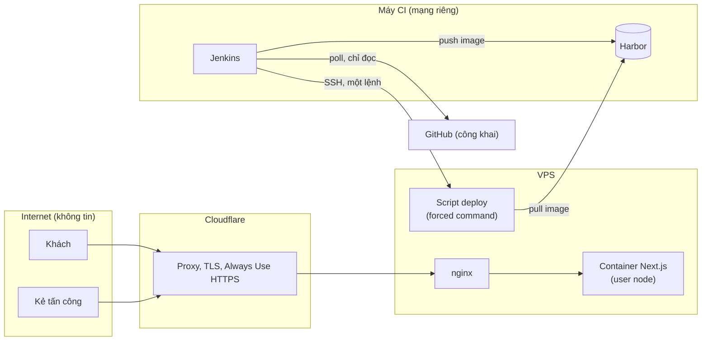

# Mô hình đe doạ

> Trạng thái: Đang áp dụng · Cập nhật: 2026-10-18 · Liên quan: [Kiến trúc](../architecture/ARCHITECTURE.md), [Yêu cầu phi chức năng](../product/nfr.md), [Cấu hình](../dev/configuration.md), [Triển khai](../ops/deployment.md), [Runbook](../ops/runbooks/README.md)

Bản ngắn (tầng T2) cho một site giới thiệu không có tài khoản và không nhận dữ liệu. Repo công khai: file này không ghi địa chỉ, tên bí mật hay chi tiết khai thác được; cấu hình bảo vệ phía máy chủ nằm ở `qkenn04/infra-qkenn`. Tính tới 2026-10-15.

## 0. Tóm tắt một trang

| Chủ đề | Hiện trạng | Chi tiết |
|---|---|---|
| Tài khoản, phần quản trị | Không có trên site | NG3 ở [đặc tả](../product/spec.md#5-không-làm) |
| Dữ liệu khách | Form đặt bàn chỉ giữ dữ liệu trong trình duyệt, không gửi, không lưu | T04, PRIV-01 |
| Bên thứ ba chạy trên trang | Cloudflare Web Analytics (beacon do Cloudflare tự chèn, đang chạy, có trong `/privacy`). Umami (không cookie): code có sẵn, chỉ tải khi build có Website ID. Dự kiến: GA4 chỉ sau khi khách đồng ý | T04, [ADR 0007](../adr/0007-use-umami-and-consent-gated-ga4.md) |
| Đường giao hàng | Jenkins chỉ bind bí mật trong stage cần dùng; khoá deploy chỉ chạy được một lệnh; host key được ghim; khoá service account cho Search Console không có quyền Google Cloud | T05, T09, mục 4 |
| Header bảo mật | Thiếu HSTS, CSP, `X-Frame-Options`, COOP (PageSpeed 2026-10-14) | T03, việc cần làm |

## 1. Nguyên tắc

1. **Thứ không cần thì không có:** không backend, không form gửi đi, không tài khoản. Mỗi thứ thêm vào (analytics, form thật) cần ADR và cập nhật file này.
2. **Repo công khai là giả định mặc định:** mọi thứ trong repo, kể cả `Jenkinsfile`, coi như kẻ tấn công đã đọc.
3. **Khách được biết ai nhận dữ liệu của họ:** mọi bên thứ ba chạy trên trang được liệt kê ở `/privacy`.
4. **Lớp bảo vệ chưa có cách kiểm thì coi như chưa có.**

## 2. Tài sản cần bảo vệ

| # | Tài sản | Vì sao quan trọng | Nằm ở đâu | Lớp bảo vệ chính |
|---|---|---|---|---|
| TS1 | Đường deploy (Jenkins, quyền push registry, khoá deploy) | Chiếm được là chạy được code tuỳ ý trên production | Máy CI, Jenkins Credentials | L4 |
| TS2 | Nội dung và uy tín của site | Trang bị sửa, hoặc giờ, hotline, giá sai làm khách mất lòng tin và gọi nhầm | Repo, image trên VPS | L1, review, chủ quán duyệt |
| TS3 | Domain `thehot.vn`, zone Cloudflare, tài khoản Google (Search Console, Business Profile); service account Google là user của property Search Console (gửi lại sitemap sau deploy) | Mất là mất cả site và hiện diện trên Google | Ngoài repo, chủ quán và chủ repo quản lý; khoá service account trong Jenkins Credentials; phiên đăng nhập Google trong profile Chrome của script Rich Results Test trên máy dev (T11) | Ngoài phạm vi repo `[CẦN XÁC NHẬN: tài khoản đã bật 2FA chưa]` |
| TS4 | Dữ liệu khách nhập vào form; số liệu truy cập của khách | Dữ liệu cá nhân, trách nhiệm pháp lý | Trình duyệt của khách; công cụ analytics (dự kiến) | L1, L7 |
| TS5 | Repo GitHub công khai | Nguồn của mọi build; secret lỡ commit thì lộ ngay | GitHub | Review, L8 (chưa có) |

## 3. Mô hình đe doạ

### 3.1 Tác nhân

| Mã | Tác nhân | Khả năng | Mục tiêu thường gặp |
|---|---|---|---|
| A1 | Bot, scanner trên internet | Quét, khai thác lỗ hổng đại trà | Lỗ hổng Next.js, file lộ |
| A2 | Kẻ tấn công có chủ đích | Đọc repo công khai (kể cả `Jenkinsfile`), phishing | Đường deploy, tài khoản Cloudflare và Google |
| A3 | Chuỗi cung ứng | Gói npm, image Node, plugin Jenkins bị chèn mã hoặc có lỗ hổng | Build, runtime |
| A4 | Thao tác nhầm (người hoặc agent AI) | Có quyền trong phiên làm việc | Commit secret, sửa sai thông tin quán, thêm script theo dõi mà quên `/privacy` |
| A5 | Sự cố không do người | Máy CI tắt đột ngột, VPS ngừng | Tính sẵn sàng, khả năng deploy |

### 3.2 Ranh giới tin cậy

Ranh giới cần giữ:

- **Internet → ứng dụng:** chỉ qua Cloudflare và nginx; container không mở cổng ra Internet (cấu hình ở repo infra).
- **CI → VPS:** chỉ một lệnh deploy nhận commit SHA; không shell. Host key của VPS được ghim trong Jenkins.
- **GitHub → CI:** Jenkins chỉ build nhánh `main` đã qua review; PR từ bên ngoài không được build tự động.

### 3.3 Bảng đe doạ

| # | Đe doạ | Đường vào | Hậu quả | Lớp chặn | Kiểm bằng | Trạng thái |
|---|---|---|---|---|---|---|
| T01 | Lộ secret qua repo công khai | A4 → commit | Mất TS1 | Ứng dụng không dùng secret; secret CI chỉ nằm trong Jenkins Credentials | Review PR | Một phần: chưa có quét secret tự động (L8) |
| T02 | Gói npm, image nền hoặc plugin có mã độc hay lỗ hổng | A3 → build, runtime | Chạy mã lúc build hoặc trong container | `package-lock.json` + `npm ci`; image Node ghim tag; container chạy user `node`; build trong Docker riêng của máy CI | — | Một phần: pipeline chưa quét và chặn theo lỗ hổng; image nền ghim tag, chưa ghim digest |
| T03 | Nhúng site vào iframe (clickjacking), hạ cấp HTTPS lần đầu truy cập | A1, A2 → trình duyệt khách | Lừa khách bấm, nghe lén lần truy cập HTTP đầu | Always Use HTTPS (Cloudflare) | `curl -sI https://thehot.vn/` | Chưa đủ: thiếu HSTS, `X-Frame-Options`/`frame-ancestors`, CSP |
| T04 | Script bên thứ ba nhận dữ liệu khách ngoài điều `/privacy` mô tả, hoặc trước khi khách đồng ý | A4, A3 → thêm script | Vi phạm riêng tư, rủi ro pháp lý | Mọi sự kiện đi qua `track()` (`src/lib/analytics.ts`), chỉ gửi tham số trong danh sách cho phép; Umami chỉ tải khi build có Website ID và chỉ đếm trên `thehot.vn`; mục Umami của `/privacy` chỉ hiện khi tracker được tải; GA4 chỉ tải sau đồng ý; `/privacy` liệt kê bên thứ ba | DevTools Network và Cookies; smoke test kiểm tracker khớp Website ID | Một phần: Umami và Cloudflare Web Analytics đã có trong `/privacy` (chữ chờ chủ quán duyệt); GA4 chưa làm |
| T05 | Dùng quyền Jenkins hoặc khoá deploy để chạy lệnh tuỳ ý trên VPS | A2 → máy CI, khoá deploy | Chiếm TS1, sửa site | Forced command; khoá chỉ dùng được từ mạng riêng; host key ghim; Jenkins không mở ra Internet | Cấu hình ở repo infra | Có |
| T06 | Thông tin quán sai trên site (sửa nhầm, hoặc lệch giữa các chỗ) | A4 → PR | Khách đến sai giờ, gọi nhầm số | Một nguồn `site.ts` (I-01); chủ quán duyệt; review | Kiểm tay, Rich Results Test | Một phần: còn chỗ gõ lại (I-01), giờ lệch Google Maps |
| T07 | Site hoặc khả năng deploy ngừng do sự cố hạ tầng | A5 | Khách không vào được; không sửa được site | Tự rollback khi healthcheck lỗi; VPS giữ image cũ; lỗi CI không chạm VPS | [Runbook 001](../ops/runbooks/001-jenkins-git-cache-corrupted.md) | Có |
| T08 | JSON-LD chèn chuỗi chứa `</script>` làm vỡ trang hoặc chèn script | A4 → dữ liệu | XSS | Dữ liệu JSON-LD là hằng số trong repo; nếu sau này lấy dữ liệu từ ngoài thì phải escape `<` trước khi nhúng | Review | Có (với dữ liệu hiện tại) |
| T09 | Lộ khoá service account dùng cho Search Console ([ADR 0009](../adr/0009-notify-search-engines-after-deploy.md)) | A2 → máy CI; A4 → in khoá ra log | Gửi hoặc xoá sitemap, đọc số liệu Search Console của `thehot.vn`; không sửa được site, không có quyền Google Cloud | Khoá chỉ nằm trong Jenkins Credentials, chỉ bind trong stage Notify search engines; script không in khoá hay token (token đi vào `curl` qua stdin); service account không có vai trò Google Cloud nào; xoay vòng hằng năm | Review `ci/notify-search.sh`; danh sách user trong Search Console | Có; thu hồi theo repo infra |
| T10 | Người khác dùng khoá IndexNow (công khai theo thiết kế) gửi URL của `thehot.vn` | A1 | Gửi nhiều có thể làm IndexNow tạm từ chối site (429); chỉ gửi được URL trên `thehot.vn` | Chấp nhận; đổi khoá bằng cách đổi tên file `public/<khoá>.txt` | Log stage Notify search engines | Rủi ro chấp nhận |
| T11 | Lộ phiên đăng nhập Google trong profile Chrome của script Rich Results Test ([ADR 0010](../adr/0010-check-rich-results-with-signed-in-chrome.md)) | A2 → mã độc hoặc người khác trên máy dev; A4 → chép hoặc commit thư mục profile | Dùng được tài khoản Google đó như chủ của nó; nếu tài khoản có quyền Search Console hoặc Business Profile của quán thì mất TS3 | Profile riêng, không phải profile Chrome hằng ngày, nằm ngoài repo (`~/.local/share/thehot-rrt/`, quyền `0700`); script không đọc hay in cookie, trang kết quả được tải không kèm cookie; không chạy trong CI | `stat` thư mục profile; Google Account → Security → Your devices | Một phần: `[CẦN XÁC NHẬN: tài khoản đang đăng nhập trong profile có quyền gì với Search Console, Business Profile của quán]` |

## 4. Lớp bảo vệ

| # | Lớp | Chặn đe doạ | Làm ở đâu | Trạng thái |
|---|---|---|---|---|
| L1 | Không tài khoản, không backend, form không gửi dữ liệu | T04, T08 và cả nhóm đe doạ đăng nhập, injection | Thiết kế ([đặc tả](../product/spec.md)) | Có |
| L2 | Container chạy user không phải root, có healthcheck | T02 | `Dockerfile` | Có |
| L3 | Cloudflare proxy, Always Use HTTPS; nginx dùng chứng chỉ Origin CA | T03 | Cloudflare, repo infra | Có `[CẦN XÁC NHẬN: chế độ Full (strict)]` |
| L4 | Bí mật CI bind theo stage, đăng xuất registry sau push, forced command, host key ghim, khoá Search Console không có quyền Google Cloud | T01, T05, T09 | `Jenkinsfile`, repo infra | Có |
| L5 | Lockfile, `npm ci`, image Node ghim phiên bản | T02 | `package-lock.json`, `Dockerfile` | Có |
| L6 | Header bảo mật HSTS, `X-Frame-Options` hoặc CSP `frame-ancestors`, `X-Content-Type-Options` | T03 | Cloudflare hoặc nginx (repo infra) | Chưa có |
| L7 | GA4 sau đồng ý, danh sách tham số cho phép, `/privacy` đầy đủ | T04 | `src/lib/analytics.ts`, `legal/content.ts` | Một phần: danh sách cho phép và `/privacy` cho Umami, Cloudflare có trong code; GA4 đề xuất ([ADR 0007](../adr/0007-use-umami-and-consent-gated-ga4.md)) |
| L8 | Quét secret cho repo công khai | T01 | CI hoặc GitHub | Chưa có |
| L9 | Quét lỗ hổng phụ thuộc và image, có ngưỡng chặn | T02 | Pipeline | Chưa có trong `Jenkinsfile` |

## 5. Bí mật

Ứng dụng không có bí mật. Bí mật của đường giao hàng: [Cấu hình, mục 5](../dev/configuration.md#5-bí-mật-nơi-giữ-xoay-vòng-thu-hồi). Khi làm việc với agent AI: không dán giá trị bí mật vào hội thoại; không đưa địa chỉ máy chủ, tên bí mật hay đường dẫn trên máy chủ vào repo này.

## 6. Việc cần làm

- [ ] L6: thêm HSTS (Cloudflare Edge Certificates hoặc nginx), `X-Frame-Options: DENY` hoặc CSP `frame-ancestors 'none'`, `X-Content-Type-Options: nosniff`. Làm ở `qkenn04/infra-qkenn`; kiểm bằng `curl -sI https://thehot.vn/`.
- [x] T04: ghi Cloudflare Web Analytics vào `/privacy` ([ADR 0007](../adr/0007-use-umami-and-consent-gated-ga4.md)); thay mục "Tùy chọn hiển thị" của `/privacy` bằng "Cookie và lưu trữ trên trình duyệt" (code không dùng cookie, `sessionStorage` hay `localStorage`) · spec 004 PR A, chữ chờ chủ quán duyệt. Nếu sau này tắt Cloudflare Web Analytics thì bỏ mục đó.
- [ ] L8: chọn và bật quét secret.
- [ ] L9: quyết định ngưỡng chặn theo kết quả quét lỗ hổng image.
- [ ] T11: kiểm tài khoản Google đang đăng nhập trong profile của script Rich Results Test; nếu có quyền Search Console hoặc Business Profile của quán thì đổi sang tài khoản không có quyền (`RRT_PROFILE` trỏ tới thư mục mới, chạy `check.mjs --login`), rồi đăng xuất phiên cũ.

## 7. Rủi ro đã chấp nhận

| Rủi ro | Vì sao chấp nhận | Người chấp nhận | Xem lại khi |
|---|---|---|---|
| Dùng ảnh nền `hero-backdrop.jpg` và vài SVG của template NOKTO trên site công khai, đã index | Chưa có ảnh thay; chủ quán chọn giữ giao diện hiện tại | Chủ quán ([ADR 0003](../adr/0003-allow-search-indexing.md)) | Có ảnh của quán hoặc phương án gradient được duyệt |
| Một VPS, không bản dự phòng | Site giới thiệu, chi phí thấp | `[CẦN XÁC NHẬN: chủ repo và chủ quán]` | Khi có yêu cầu sẵn sàng cao hơn (AVAIL-01) |
| Khoá IndexNow nằm công khai ở `https://thehot.vn/<khoá>.txt` (T10) | IndexNow bắt buộc như vậy; khoá chỉ dùng được cho URL trên `thehot.vn` | Chủ repo, khi chấp nhận [ADR 0009](../adr/0009-notify-search-engines-after-deploy.md) `[CẦN XÁC NHẬN]` | IndexNow trả 429 hoặc 403 không rõ lý do |
| Repo công khai, `Jenkinsfile` lộ tên máy CI trong mạng riêng | Repo được chọn để công khai (2026-10-10); máy CI và VPS chỉ nhận kết nối deploy từ mạng riêng | Chủ repo chọn công khai; việc chấp nhận phần lộ trong `Jenkinsfile`: `[CẦN XÁC NHẬN]` | Khi đổi kiến trúc mạng |

## 8. Câu hỏi mở

- [CẦN XÁC NHẬN: tài khoản Cloudflare, Google, GitHub của quán và chủ repo đã bật xác thực 2 lớp chưa]
- [CẦN XÁC NHẬN: giữ hay tắt Cloudflare Web Analytics khi đã có Umami]
