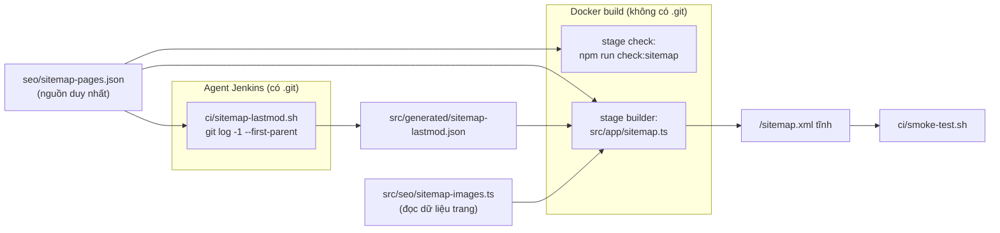

# 001: Sitemap tự động, kế hoạch kỹ thuật

> Trạng thái: Đang áp dụng · Cập nhật: 2026-10-14 · Liên quan: [spec.md](spec.md), [tasks.md](tasks.md), [Triển khai](../../ops/deployment.md), [Mục lục ADR](../../adr/README.md) (ADR 0004)

Kế hoạch này mô tả **bản đã xây** (PR #3), kèm các điểm lệch so với kế hoạch ban đầu và lý do.

## 1. Tóm tắt cách làm

Một file cấu hình `seo/sitemap-pages.json` là nguồn duy nhất về trang. Ngày `lastmod` được tính trên agent Jenkins (nơi có `.git`) trước khi build Docker, vì `.dockerignore` loại `.git` khỏi build context. Một script Node thuần chạy trong stage `check` của Docker so cấu hình với các file `page.*` trong `src/app` và làm build thất bại khi lệch. `src/app/sitemap.ts` đọc cấu hình, file ngày và danh sách ảnh, rồi Next.js sinh `/sitemap.xml` tĩnh lúc build.

Cách C (ngày từ git) được chọn thay cho ngày build (mọi trang đổi ngày mỗi lần deploy, Google sẽ bỏ qua `lastmod`) và thay cho ngày gõ tay (dễ quên, đã sai một lần).

## 2. Thiết kế



Thứ tự stage trong `Jenkinsfile`: `Sitemap dates` → `Check` → `Build` → `Smoke test` → `Push` → `Deploy`.

| File | Mới / sửa | Vai trò |
|---|---|---|
| `seo/sitemap-pages.json` | mới | Trang, nguồn của từng trang, file dùng chung, loại trừ |
| `seo/check-sitemap-pages.mjs` | mới | Kiểm cấu hình khớp `src/app` (Node thuần, không thư viện) |
| `ci/sitemap-lastmod.sh` | mới | Tính ngày từ git, ghi `src/generated/sitemap-lastmod.json` |
| `src/seo/sitemap-images.ts` | mới | Ảnh của từng trang, lấy từ module dữ liệu trang |
| `src/components/sites/the-hot/menuPages.ts` | mới | `menuPages` tách khỏi `MenuBook.tsx` (file `"use client"`) để code phía server đọc được |
| `src/components/sites/the-hot/videos.ts` | sửa | Thêm `heroVideo` (poster hero) thay vì gõ thẳng trong `src/app/page.tsx` |
| `src/app/sitemap.ts` | sửa | Đọc ba nguồn trên; ném lỗi khi danh sách ảnh trỏ tới path không có trong cấu hình |
| `Jenkinsfile` | sửa | Stage `Sitemap dates` trước `Check` |
| `Dockerfile` | sửa | Stage `check` chạy thêm `npm run check:sitemap` |
| `package.json` | sửa | Script `check:sitemap`; `check` = lint + typecheck + `check:sitemap` + build |
| `.gitignore` | sửa | `src/generated/` |
| `ci/smoke-test.sh` | sửa | Kiểm sitemap trên image vừa build (mục 6) |
| `README.md`, `AGENTS.md`, `CONTRIBUTING.md`, `.github/PULL_REQUEST_TEMPLATE.md` | sửa | Lệnh `check:sitemap`, stage mới, nhắc khai trang mới khi đóng góp |

## 3. Lệch so với kế hoạch ban đầu

| # | Kế hoạch ban đầu | Bản đã xây | Lý do |
|---|---|---|---|
| 1 | Script kiểm đặt trong `ci/` | Đặt trong `seo/` | `.dockerignore` loại `ci/`, `docs/`, `scripts/` khỏi build context, mà bước kiểm chạy trong stage `check` của Docker. Script tính ngày vẫn ở `ci/` vì nó chạy trên agent Jenkins, không trong Docker. |
| 2 | `git log -1 -- <sources>` | `git log -1 --first-parent -- <sources>` | Trang đổi qua PR mang ngày PR được merge vào `main` (lúc thay đổi lên production), không phải ngày commit trên nhánh tính năng, có thể sớm hơn vài ngày. |
| 3 | `shared` chỉ có `site.ts` | `site.ts` và `SiteFooter.tsx` | Footer hiện trên mọi trang (giờ mở cửa, hotline). |
| 4 | Ảnh cho `/`, `/menu`, `/menu/list`, `/about` | Ảnh cho cả 6 trang, gồm `/reservation` (poster video About) và `/terms` (ảnh của trang thông tin); trang chủ thêm poster sự kiện | Khai đủ mọi ảnh thật trang đó hiển thị. `about.heroImage` bị bỏ vì không component nào render nó. Kết quả: 25 mục, 19 file khác nhau. |
| 5 | Kiểm: route chưa khai, path cấu hình không có trang, nguồn không tồn tại | Thêm: path trùng, mẫu route động phải khai trong `dynamic`, `sources` phải bao gồm file `page.*` của trang; bỏ qua thư mục private `_x`, route chặn `(.)x`, slot song song `@x`, nhóm route `(x)` | Bắt thêm các lỗi dễ gặp khi cấu hình lớn dần. |
| 6 | Smoke test giữ nguyên | Thêm `/menu/list`, `/sitemap.xml`; mỗi `<url>` có `<lastmod>`; mọi `<loc>`/`<image:loc>` nằm trên origin của site, trả 200 không chuyển hướng, ảnh là `image/*` | Bắt lỗi quên chạy script ngày và ảnh sai đường dẫn ngay trước khi push. |
| 7 | Script ngày bản nháp | Kiểm có `git`/`jq`, xoá file cũ trước khi ghi, kiểm dạng cấu hình bằng `jq`, `GIT_LITERAL_PATHSPECS=1`, mọi path phải có ít nhất một commit | Không để file ngày cũ hoặc sai lọt vào build. |
| 8 | Giữ `changeFrequency`, `priority` | Bỏ | Google bỏ qua hai trường này. |
| 9 | — | `sitemap.ts` bỏ `/` cuối của `NEXT_PUBLIC_SITE_URL`, trang chủ là origin trần | Không sinh `//` trong URL. |

## 4. Thay đổi kéo theo

| Loại | Thay đổi | Tài liệu |
|---|---|---|
| Vận hành | Stage Jenkins mới `Sitemap dates`; job phải checkout đủ lịch sử (không shallow) | [Triển khai](../../ops/deployment.md) |
| Cấu hình | Không thêm biến; dùng `NEXT_PUBLIC_SITE_URL` có sẵn | — |
| Quy ước repo | Thêm trang mới thì khai trong `seo/sitemap-pages.json` | README (mục đóng góp) |

## 5. Thứ tự làm (đã làm)

1. `bfbdd16` cấu hình duy nhất + kiểm lệch + thêm `/terms`.
2. `f22785c` tách dữ liệu ảnh (`menuPages`, `heroVideo`) để phía server đọc được.
3. `8c8807d` sitemap ảnh.
4. `0aba912` `lastmod` từ git + stage Jenkins + `.gitignore`.
5. `13d4d60` siết kiểm tra, phủ ảnh của mọi trang, mở rộng smoke test.
6. `3c4f113` nhắc bước kiểm sitemap trong `CONTRIBUTING.md` và mẫu PR.

Mỗi commit để build xanh được độc lập.

## 6. Kiểm thử

| Tiêu chí | Kiểm bằng | Loại |
|---|---|---|
| 001-AC-01, 001-AC-07 | `ci/smoke-test.sh` (mọi build) | I |
| 001-AC-02 | Smoke test đếm `<lastmod>`; build lại cùng commit so ngày | I, M |
| 001-AC-03, 001-AC-04, 001-AC-06 | Thử trong một bản clone tạm trước khi merge (ghi ở PR #3) | M |
| 001-AC-05 | `npm run check:sitemap`, stage `check` | S |
| 001-AC-08 | `curl -s https://thehot.vn/sitemap.xml` | E |
| 001-AC-09 | Search Console → Sitemaps | E |

Kiểm nhanh trên production:

```bash
curl -s https://thehot.vn/sitemap.xml | grep -c '<url>'          # 6
curl -s https://thehot.vn/sitemap.xml | grep -c '<lastmod>'      # 6
curl -s https://thehot.vn/sitemap.xml | grep -c '<image:loc>'    # 25 (tính tới 2026-10-14)
```

## 7. Rủi ro và cách lùi

| Rủi ro | Dấu hiệu | Giảm thiểu | Lùi lại thế nào |
|---|---|---|---|
| Stage `Sitemap dates` lỗi (thiếu công cụ, clone nông) | Build dừng trước `Check` | Script báo lý do cụ thể | Sửa agent; hoặc revert commit `0aba912` (sitemap vẫn chạy, không có `lastmod`) |
| Script kiểm báo lệch sai | Stage `check` đỏ dù cấu hình đúng | Thông báo nêu từng lỗi | Sửa script; tạm gỡ `check:sitemap` khỏi `Dockerfile` |
| Commit chỉ đổi code (hiệu ứng, refactor) trong thư mục trang làm đổi `lastmod` | Ngày đổi dù nội dung không đổi | Chấp nhận; vẫn tốt hơn ngày build. Có thể thu hẹp `sources` về file nội dung sau | — |
| Quên khai thư mục nguồn khi trang dùng component mới | Đổi component mà ngày không đổi | Review PR; script báo nếu path không tồn tại | Thêm path vào `sources` |
| Sitemap sai trên production | `curl` thấy sai | Smoke test chặn phần lớn trường hợp | Revert PR, Jenkins deploy bản trước |

Ghi chú: Next.js ghi `<image:image>` trước `<lastmod>`. Google chấp nhận; bộ kiểm XSD nghiêm ngặt có thể báo. Sau lần deploy đầu, phần lớn trang mang ngày merge của PR #3 hoặc #5 vì hai PR đó chạm nguồn của chúng; từ sau, ngày đi theo thay đổi thật.

## 8. Ước lượng

Kế hoạch ban đầu: khoảng 4–5 giờ (ước lượng thô). Thực tế: làm, review và merge trong ngày 2026-10-14; số giờ không ghi lại.

## 9. Câu hỏi mở

Không có.
