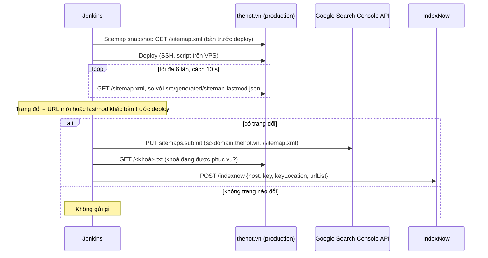

# 001: Sitemap tự động

> Trạng thái: Đang áp dụng · Cập nhật: 2026-10-15 · Liên quan: [Mục lục spec](../README.md), [plan.md](plan.md), [tasks.md](tasks.md), [Mục lục ADR](../../adr/README.md) (ADR 0004, ADR 0009), [Lộ trình M1](../../plan/roadmap.md#m1-nền-tảng-seo)

`/sitemap.xml` của https://thehot.vn cho Google và Bing biết site có những trang nào, trang nào vừa đổi và mỗi trang có ảnh nào của quán. Trước spec này, sitemap là một mảng 5 URL gõ tay trong `src/app/sitemap.ts`, `lastmod` gõ cứng là `2026-10-12` và thiếu trang `/terms`. Spec này thay bằng sitemap sinh từ một file cấu hình duy nhất, ngày lấy từ lịch sử git, và có bước kiểm làm build thất bại khi cấu hình lệch với trang thật.

Hiện thực: xong, PR #3 (merge `b8e2665`), chạy trên production từ Jenkins build #11; bản đang chạy là build #16 (`90f1882`). Phần mở rộng "báo máy tìm kiếm sau deploy" (mục 13, [ADR 0009](../../adr/0009-notify-search-engines-after-deploy.md), đề xuất 2026-10-15) chạy trên production từ Jenkins build #29 (PR #18, merge `4a61480`): lần đầu gửi 6 trang, Google HTTP 204, IndexNow 202. Trạng thái chi tiết ở [tasks.md](tasks.md) và [tiến độ](../../plan/progress.md).

## 1. Mục tiêu

1. Sitemap liệt kê đúng 6 trang muốn index: `/`, `/menu`, `/menu/list`, `/about`, `/reservation`, `/terms`. `/privacy` cố ý để ngoài.
2. `lastmod` của mỗi trang là ngày thay đổi nội dung của trang đó vào nhánh `main`, không phải ngày build và không gõ tay.
3. Thêm hoặc xoá trang mà quên khai báo thì build báo lỗi rõ ràng, không lặng lẽ sinh sitemap thiếu.
4. Mỗi trang khai ảnh thật của quán mà trang đó hiển thị (sitemap ảnh), lấy từ chính dữ liệu trang.
5. Sau mỗi deploy, Google và các máy tìm kiếm dùng IndexNow được báo ngay những trang có `lastmod` đổi, không cần ai bấm Request indexing (mục 13).

**Hiện trạng trước spec (kiểm ngày 2026-10-14):**

| Điểm | Trước | Sau |
|---|---|---|
| Danh sách trang | 5 URL gõ tay, thiếu `/terms` | 6 URL từ `seo/sitemap-pages.json` |
| `lastmod` | Gõ cứng `2026-10-12`, dù commit `d0a8e34` (14/10) đã sửa mọi trang | Ngày commit theo từng trang |
| `changefreq`, `priority` | Có (Google bỏ qua) | Bỏ |
| Ảnh | Không khai | 25 mục ảnh, 19 file khác nhau |

## 2. Câu chuyện người dùng

| # | Là | Tôi muốn | Để |
|---|---|---|---|
| U1 | Googlebot / Bingbot | đọc một sitemap đúng và có ngày tin được | ưu tiên crawl lại đúng trang vừa đổi |
| U2 | Chủ quán | thấy trong Search Console mọi trang chính đã được khám phá | biết site có mặt đầy đủ trên Google |
| U3 | Dev | thêm trang mới mà không phải nhớ sửa sitemap bằng tay | không có trang bị bỏ sót |
| U4 | Chủ quán | sửa nội dung mà không phải vào Search Console bấm Request indexing | Google và Bing biết trang đổi ngay sau deploy |

## 3. Giao diện

Không có giao diện. Đầu ra công khai:

- `GET /sitemap.xml`: XML sitemap, mỗi `<url>` có `<loc>`, `<lastmod>` và các `<image:image>`.
- `GET /robots.txt`: cho phép tất cả, có dòng `Sitemap: https://thehot.vn/sitemap.xml` (không đổi trong spec này).
- `GET /<khoá IndexNow>.txt`: file `public/<32 ký tự hex>.txt`, `text/plain`, nội dung đúng bằng khoá (mục 13).

## 4. Dữ liệu

Site không có cơ sở dữ liệu. Nguồn dữ liệu của sitemap:

- `seo/sitemap-pages.json`: nguồn duy nhất về trang. Trường `pages[]` (`path`, `sources[]`), `shared[]` (file hiện trên mọi trang, và `src/seo/page-meta.ts` chứa tiêu đề, mô tả của mọi trang), `exclude[]` (trang cố ý để ngoài), `dynamic[]` (mẫu route động, hiện chưa dùng).
- `src/generated/sitemap-lastmod.json`: sinh lúc CI, không commit (`.gitignore`). Dạng `{ "<path>": "<ISO 8601 có múi giờ>" }`.
- Ảnh: đọc từ các module dữ liệu mà trang đang render (`galleryPhotos`, `homeEvents`, `menuPages`, `about`, `terms`, `heroVideo`, `aboutVideo`, `kitchenVideo`).

## 5. API

Site không có API; chỉ có các route tĩnh ở mục 3. Jenkins gọi hai API ngoài sau deploy (mục 13): Search Console API `sitemaps.submit` và IndexNow.

## 6. Quy tắc và kiểm tra

1. Sitemap chỉ chứa các trang trong `pages`. Mọi route có thể truy cập trong `src/app` phải nằm trong đúng một nhóm: `pages`, `exclude` hoặc `dynamic`.
2. Mỗi trang trong `pages` phải có file `page.*` tương ứng, `sources` không rỗng, mọi đường dẫn nguồn tồn tại, và `sources` phải bao gồm chính file `page.*` của trang.
3. `lastmod` của một trang = ngày commit (committer date, ISO 8601 có múi giờ) của commit cuối cùng trên lịch sử first-parent của nhánh đang build chạm vào `sources` của trang hoặc file `shared`. Trang đổi qua PR mang ngày merge PR vào `main`.
4. Commit chỉ sửa tài liệu, CI hay file không nằm trong `sources`/`shared` không làm đổi `lastmod` của trang nào. Thay đổi chưa commit không được tính.
5. Clone nông (shallow) thì dừng build, không ghi ngày sai. Đường dẫn nguồn chưa từng có commit nào chạm tới thì cũng dừng.
6. Không có file ngày (build ở máy dev chưa chạy script) thì bỏ trống `<lastmod>`, không bịa ngày.
7. Ảnh: chỉ ảnh thật của quán mà trang hiển thị; mỗi ảnh một lần trong một trang; cùng một ảnh được phép xuất hiện ở nhiều trang. Không bao giờ khai ảnh nền template `hero-backdrop.jpg`, SVG trang trí, icon, logo, ảnh OG. URL là file tĩnh gốc, không phải `/_next/image?...`.
8. Mọi URL là URL tuyệt đối trên `NEXT_PUBLIC_SITE_URL` (bỏ dấu `/` cuối nếu có); trang chủ là origin trần `https://thehot.vn`.
9. Tiêu đề và mô tả cho tìm kiếm (`src/seo/page-meta.ts`) tính là nội dung của trang: file nằm trong `shared`, nên sửa mô tả của một trang làm đổi `lastmod` của mọi trang (ước lượng dư có chủ ý, đơn giản hơn tách file theo trang). Tương tự, `src/components/sites/the-hot/videos.ts` là nguồn của bốn trang.

## 7. Trạng thái trống, lỗi, đang tải

| Tình huống | Kết quả | Ghi lại |
|---|---|---|
| Thêm `src/app/<x>/page.tsx` mà không khai | Stage `check` của Docker build thất bại, thông báo nêu route thiếu | Log Jenkins |
| Clone nông, thiếu `git` hoặc `jq` trên agent | Stage `Sitemap dates` thất bại trước khi build, chưa deploy gì | Log Jenkins |
| `src/seo/sitemap-images.ts` khai ảnh cho path không có trong cấu hình | Build thất bại (`sitemap.ts` ném lỗi) | Log build |
| Image build thiếu file ngày | Smoke test thất bại ở kiểm "mỗi `<url>` có `<lastmod>`" | Log Jenkins |
| Build local không chạy script | Sitemap không có `<lastmod>`, có cảnh báo trên console | Console build |
| Báo máy tìm kiếm sau deploy lỗi (mục 13.3) | Stage `Notify search engines` vàng, build vẫn xanh, site không bị ảnh hưởng | Log Jenkins, tin Discord |

## 8. Tiêu chí nghiệm thu

Loại kiểm: xem [mục lục spec, mục 4](../README.md#4-quy-ước).

| Mã | Cho (Given) | Khi (When) | Thì (Then) | Loại |
|---|---|---|---|---|
| 001-AC-01 | Image production đã build | `GET /sitemap.xml` | Có đúng 6 `<url>`: `/`, `/menu`, `/menu/list`, `/about`, `/reservation`, `/terms`; không có `/privacy` | I, E |
| 001-AC-02 | CI đã chạy `ci/sitemap-lastmod.sh` | `GET /sitemap.xml` | Mỗi `<url>` có `<lastmod>`; build lại cùng commit cho ra cùng ngày | I, M |
| 001-AC-03 | Một commit chỉ sửa README, `docs/` hoặc CI | Chạy lại script | Không trang nào đổi `lastmod` | M |
| 001-AC-04 | Một commit chỉ sửa nguồn của `/about` | Chạy lại script | Chỉ `/about` đổi ngày; sửa `site.ts`, `SiteFooter.tsx` hoặc `src/seo/page-meta.ts` thì mọi trang đổi | M |
| 001-AC-05 | Thêm `src/app/thu-nghiem/page.tsx` không khai báo | `npm run check:sitemap` hoặc stage `check` | Thoát mã 1, thông báo nêu route thiếu | S |
| 001-AC-06 | Workspace là clone nông | `bash ci/sitemap-lastmod.sh` | Thoát mã 1, không ghi file | M |
| 001-AC-07 | Image production đã build | Smoke test đọc mọi `<loc>` và `<image:loc>` | Mọi URL nằm trên origin của site, trả 200, ảnh có `content-type` `image/*`, không chuyển hướng | I |
| 001-AC-08 | Production | `GET /sitemap.xml` | Không có `hero-backdrop.jpg`, `.svg`, logo hay ảnh OG trong `<image:loc>` | E |
| 001-AC-09 | Sitemap đã gửi trong Search Console | Google đọc lại sitemap | Mục Sitemaps báo *Success*, 6 trang được khám phá | E |
| 001-AC-10 | Bản chụp sitemap trước deploy có một trang khác `lastmod` | Stage `Notify search engines` (hoặc `DRY_RUN=1`) | Chỉ trang đó nằm trong `urlList` gửi IndexNow; Google nhận `sitemaps.submit` (HTTP 2xx) | M, E |
| 001-AC-11 | Không trang nào đổi `lastmod` (ví dụ PR chỉ sửa tài liệu) | Stage `Notify search engines` | Log "no page changed … nothing to send"; không request nào tới Google hay IndexNow | M |
| 001-AC-12 | Thiếu khoá Google, khoá rỗng, API lỗi hoặc quá 5 phút | Stage `Notify search engines` | Stage `UNSTABLE`, build `SUCCESS`, Discord báo chưa báo được; thiếu khoá Google thì IndexNow vẫn được gửi | M |
| 001-AC-13 | Image production | `GET /<khoá>.txt` | 200, `text/plain`, nội dung đúng bằng khoá; khoá không nằm trong sitemap | I, E |

## 9. Ngoài phạm vi

- Đổi tên file ảnh và thay ảnh độ phân giải cao: việc tiếp theo, xem [tasks.md](tasks.md#việc-tiếp-theo-pr-2-đổi-tên-ảnh-và-ảnh-độ-phân-giải-cao).
- Danh sách ảnh trong JSON-LD (`Restaurant.image`): thuộc [002](../002-onpage-seo/spec.md).
- Sitemap video, `changefreq`, `priority` (Google bỏ qua hai trường sau).
- Trang động: chưa có; khi có thì khai trong `dynamic` và mở rộng spec.
- Sửa `robots.txt`.
- Google Indexing API (chỉ dành cho `JobPosting`, `BroadcastEvent`; [ADR 0009](../../adr/0009-notify-search-engines-after-deploy.md)).
- Báo IndexNow về URL bị xoá khỏi sitemap: script chỉ ghi chúng vào log.
- Gửi lại thông báo đã lỗi ở lần deploy trước: lần deploy sau chỉ gửi trang đổi ở lần đó.

## 10. Phụ thuộc

- Cần: tên miền `thehot.vn` và cho phép index (ADR 0002, ADR 0003; xem [mục lục ADR](../../adr/README.md)); Jenkins checkout đủ lịch sử git.
- Chặn: [002](../002-onpage-seo/spec.md) dùng lại quy ước ảnh thật cho `Restaurant.image`; trang mới ở M5 (sự kiện, bài viết) tự vào sitemap khi được khai trong cấu hình.

## 11. Mốc

M1 ([lộ trình](../../plan/roadmap.md#m1-nền-tảng-seo)).

## 12. Câu hỏi mở

Không có câu hỏi chặn spec này. Việc tiếp theo cần ảnh gốc từ chủ quán (xem [tasks.md](tasks.md)).

## 13. Báo máy tìm kiếm sau deploy

Thêm ngày 2026-10-15 ([ADR 0009](../../adr/0009-notify-search-engines-after-deploy.md), trạng thái Đề xuất). Script `ci/notify-search.sh`, hai stage trong `Jenkinsfile`.

### 13.1 Luồng

### 13.2 Quy tắc

1. Chỉ URL trang (`<loc>`), không tính ảnh (`<image:loc>`).
2. Trang đổi = URL có trong sitemap sau deploy mà không có trước deploy, hoặc có `<lastmod>` khác. Không có bản chụp trước deploy thì coi mọi trang là đổi.
3. Chỉ gửi khi sitemap production khớp đúng `src/generated/sitemap-lastmod.json` của build (tức site đang phục vụ bản mới), thử tối đa 6 lần cách 10 giây.
4. Google: `sitemaps.submit` cho `https://thehot.vn/sitemap.xml` trên property `sc-domain:thehot.vn`; không gọi Indexing API.
5. IndexNow: một POST tới `https://api.indexnow.org/indexnow`, `keyLocation` là `https://thehot.vn/<khoá>.txt`; 200 và 202 là thành công. Trước khi gửi, kiểm file khoá đang được phục vụ (không thì IndexNow trả 403).
6. Không bao giờ làm hỏng deploy: lỗi chỉ làm stage `UNSTABLE`; build giữ `SUCCESS`.
7. Không in khoá service account hay access token ra log.

### 13.3 Lỗi và cách xử lý

| Tình huống | Kết quả |
|---|---|
| Không đọc được sitemap trước deploy | Stage Sitemap snapshot vẫn xanh; sau deploy coi mọi trang là đổi |
| Sitemap production chưa khớp build sau 6 lần thử | Không gửi gì; stage vàng |
| Jenkins chưa có credential khoá Google, hoặc file khoá rỗng | Bỏ qua Google, vẫn gửi IndexNow; stage vàng |
| Google trả 401, 403 (service account chưa là user Full, API chưa bật) hoặc lỗi khác | Ghi mã và thông báo lỗi của Google; stage vàng |
| File khoá IndexNow chưa có trên production | Không gửi IndexNow; stage vàng |
| IndexNow trả 400, 403, 422, 429 | Ghi ý nghĩa từng mã (sai định dạng, khoá không hợp lệ, URL không thuộc host, bị coi là spam); stage vàng |

## Lịch sử thay đổi

| Ngày | Thay đổi |
|---|---|
| 2026-10-14 | Tạo từ ghi chú kế hoạch sitemap, cập nhật theo bản đã merge (PR #3); trạng thái Đang áp dụng |
| 2026-10-15 | `src/seo/page-meta.ts` vào `shared` (PR #17 sửa mô tả `/menu`, `/menu/list` mà không đổi `lastmod`); thêm mục 13 báo máy tìm kiếm sau deploy, AC-10 đến AC-13 |
