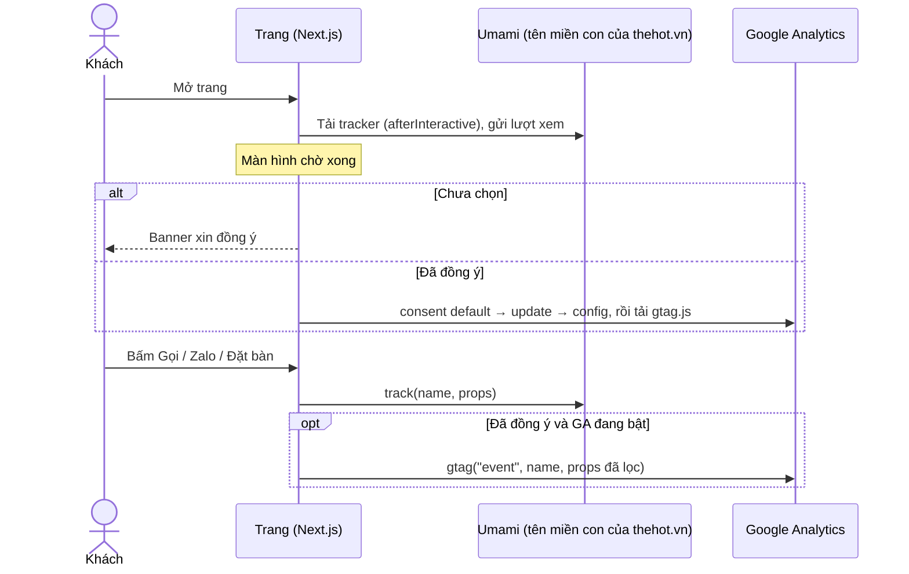

# 004: Đo lường truy cập, kế hoạch kỹ thuật

> Trạng thái: Đề xuất · Cập nhật: 2026-10-14 · Liên quan: [spec.md](spec.md), [tasks.md](tasks.md), [Triển khai](../../ops/deployment.md), [Mục lục ADR](../../adr/README.md) (ADR 0007)

Chỉ phần website. Hạ tầng Umami: tài liệu ở repo hạ tầng riêng (private).

## 1. Tóm tắt cách làm

Hai PR vào repo này, theo thứ tự:

1. **PR A, Umami** (sau khi Umami đã chạy và có Website ID): tạo `src/lib/analytics.ts` (một hàm `track()` dùng chung), một listener `ClickTracker` đọc thuộc tính `data-track*`, nạp script Umami bằng `next/script`, gắn sự kiện, sửa `/privacy`, truyền biến build qua `Jenkinsfile` → `Dockerfile`.
2. **PR B, GA4 + banner** (sau PR A): `consent.ts`, `ga.ts`, các hook, banner, nút Cài đặt cookie, link footer, phần GA4 của `track()` và `/privacy`.

PR B chỉ **thêm** vào `track()` (ở chỗ đánh dấu phần GA4), không ghi đè file. Mọi click đã đi qua `track()` nhờ `ClickTracker`, nên GA4 nhận đủ sự kiện mà không phải gắn lại. Hai PR cùng sửa `Jenkinsfile`, `Dockerfile`, `layout.tsx`, `legal/content.ts`, `ci/smoke-test.sh`; PR sau rebase.

Trước khi viết code: đọc hướng dẫn trong `node_modules/next/dist/docs/` (Script, third-party libraries, environment variables) theo `AGENTS.md`, vì Next.js 16 có thay đổi lớn.

## 2. Thiết kế



### 2.1 Cấu trúc file

```text
src/
  lib/
    analytics.ts      PR A  track(), trackAttrs(), isAnalyticsEvent(); PR B thêm nhánh GA4
    consent.ts        PR B  đọc/ghi thehot-consent, sự kiện đổi lựa chọn, mở lại banner (TS thuần)
    ga.ts             PR B  enableGa / disableGa / deleteGaCookies / sendGaEvent / gaAllowedHere
  hooks/
    useConsent.ts     PR B  useSyncExternalStore(consent)
    useSplashDone.ts  PR B  useSyncExternalStore(data-splash)
    useGaAllowed.ts   PR B
  types/
    gtag.d.ts         PR B  window.dataLayer, window.gtag (window.umami khai ở analytics.ts)
  components/analytics/
    ClickTracker.tsx  PR A  một listener click (capture) cho cả trang
    UmamiScript.tsx   PR A  next/script; không render khi thiếu biến
  components/sites/the-hot/consent/
    ConsentBanner.tsx, ConsentBanner.module.css, GoogleAnalytics.tsx, CookieSettingsButton.tsx   PR B
Sửa: src/app/layout.tsx; SiteFooter.tsx (link Bảo mật + Cài đặt cookie); PersistentChrome.tsx (tuỳ chọn);
     FloatingContact.module.css (nhấc lên khi có banner); legal/content.ts, LegalPage.tsx (/privacy);
     các component có nút (spec mục 4.1); Dockerfile, Jenkinsfile, ci/smoke-test.sh
```

### 2.2 `src/lib/analytics.ts` (giữ đúng chữ ký)

```ts
export type AnalyticsEvent =
  | "contact_click" | "booking_cta_click" | "reservation_complete"
  | "menu_view_mode" | "event_view" | "social_click";

/** Gửi một sự kiện cho Umami (luôn) và GA4 (chỉ khi đã đồng ý). Không bao giờ ném lỗi, không chặn thao tác. */
export function track(name: AnalyticsEvent, props?: Record<string, string | number>): void;

export function isAnalyticsEvent(value: string): value is AnalyticsEvent;

/** Thuộc tính `data-track*` cho link/nút; dùng được cả trong Server Component. ClickTracker đọc và gọi track(). */
export type TrackAttrs = { [key: `data-track${string}`]: string };
export function trackAttrs(name: AnalyticsEvent, props?: Record<string, string>): TrackAttrs;

declare global {
  interface Window {
    // Không có khi: build không có biến Umami, script chưa tải xong, bị trình chặn quảng cáo chặn.
    umami?: { track: (eventName: string, data?: Record<string, string | number>) => Promise<void> };
  }
}
```

- Link/nút điều hướng: `{...trackAttrs("contact_click", { method: "phone", location: "footer" })}`. Lý do dùng thuộc tính thay vì `onClick`: `SiteFooter`, `MenuViewSwitcher`, `not-found.tsx`, `ButtonLink` là Server Component, không nhận `onClick`.
- Sự kiện trạng thái (form xong, mở poster): gọi thẳng `track(...)` trong Client Component.
- `ClickTracker`: `document.addEventListener("click", …, true)` (capture, chạy trước handler của `next/link` và `motion`), không `preventDefault`; tìm phần tử gần nhất có `data-track`, gom `data-track-*` thành props.
- `ReservationForm`: `track("reservation_complete", { party_size: data.guests })` trong handler submit, ngay trước khi chuyển sang bước thành công.

### 2.3 `src/lib/consent.ts`, `src/lib/ga.ts` (PR B)

```ts
// consent.ts
export const CONSENT_KEY = "thehot-consent";
export const CONSENT_VERSION = 1;               // tăng khi nội dung xin đồng ý đổi → hỏi lại mọi người
export type ConsentRecord = { v: 1; analytics: boolean; ads: false; at: string };
export function getConsent(): ConsentRecord | null;   // null = chưa chọn hoặc hết hiệu lực (quá 12 tháng, v khác, JSON hỏng)
export function hasAnalyticsConsent(): boolean;
export function saveConsent(analytics: boolean): ConsentRecord;
export function subscribeConsent(onChange: () => void): () => void;   // gồm sự kiện storage giữa các tab
export function openConsentSettings(): void;
export function subscribeOpenSettings(onOpen: () => void): () => void;

// ga.ts
export const GA_ID: string;                    // NEXT_PUBLIC_GA_ID nếu đúng dạng G-XXXX, ngược lại ""
export function gaAllowedHere(): boolean;      // có GA_ID và hostname là của NEXT_PUBLIC_SITE_URL (dev, ?ga_debug=1 là ngoại lệ)
export function enableGa(): void;              // chỉ gọi khi đã đồng ý; idempotent; đúng thứ tự consent → config → chèn gtag.js
export function disableGa(): void;             // consent denied, ga-disable, xoá cookie _ga*
export function sendGaEvent(name: string, props?: Record<string, string | number>): void;  // lọc theo danh sách cho phép
```

Vì sao không dùng `@next/third-parties` hay `next/script` cho GA4: gói chưa cài, tài liệu Next ghi là experimental, không có tham số consent; hai thẻ `<Script>` không bảo đảm thứ tự chạy và unmount không gỡ được gtag đã chạy. Một hàm `enableGa()` chạy đúng một lần, đúng thứ tự, dễ review và dễ test hơn. Umami thì dùng `next/script` với `strategy="afterInteractive"` trong root layout (tải một lần dù chuyển trang).

Trạng thái đồng ý và màn hình chờ đọc bằng `useSyncExternalStore`: repo dùng `eslint-plugin-react-hooks` 7 (cấm `setState` đồng bộ trong effect), và server luôn render "không banner" nên không lệch hydrate.

### 2.4 Biến build

| Biến | Giá trị | Ghi chú |
|---|---|---|
| `NEXT_PUBLIC_UMAMI_WEBSITE_ID` | Website ID trong Umami | Công khai (nằm trong HTML) |
| `NEXT_PUBLIC_UMAMI_SRC` | URL tracker trên tên miền con analytics | Công khai |
| `NEXT_PUBLIC_GA_ID` | Measurement ID `G-…` | Công khai (nằm trong URL `gtag.js`) |

- Nhúng lúc `next build`: phải viết nguyên văn `process.env.NEXT_PUBLIC_X` (không destructure, không tra động). Đổi giá trị thì build lại image.
- Chỉ `Jenkinsfile` truyền (khối `environment` → `--build-arg` → `ARG`/`ENV` trong stage builder, như `NEXT_PUBLIC_SITE_URL`). Build tay không truyền thì không tải gì.
- Tracker Umami: `data-website-id`, `data-domains="thehot.vn"`, `data-exclude-hash="true"`; không đặt `data-exclude-search`, `data-do-not-track`. `data-performance` (gửi Core Web Vitals) để dành cho [003](../003-performance/spec.md) phần H.

## 3. Thay đổi kéo theo

| Loại | Thay đổi | Tài liệu |
|---|---|---|
| Cấu hình | Ba biến build mới | `docs/dev/configuration.md` (nếu có), [Triển khai](../../ops/deployment.md) |
| CI | Smoke test: HTML có Website ID khi biến được đặt; HTML không có `googletagmanager` (GA chỉ tải phía client sau đồng ý) | `ci/smoke-test.sh` |
| Quyền riêng tư | `/privacy`: mục Umami, mục GA4, Cloudflare Web Analytics; bỏ câu sai về `sessionStorage` | Spec mục 3, 6 |
| Giao diện | Banner, link footer, nút nổi dịch lên | Duyệt thiết kế |
| Bảo mật | Nếu sau này thêm Content-Security-Policy cho `thehot.vn`: cho phép tracker Umami và `googletagmanager.com`, `*.google-analytics.com` | Repo hạ tầng |

Nội dung `/privacy` (bản nháp, chủ quán duyệt):

> **Thống kê lượt truy cập.** Website dùng Umami, cài trên máy chủ riêng của website, để đếm lượt truy cập ẩn danh: trang được xem, nguồn truy cập (ví dụ Google, Facebook), loại thiết bị và trình duyệt, quốc gia/thành phố ước tính, và các lượt bấm nút liên hệ hoặc đặt bàn (kèm số khách dự kiến, không kèm tên hay số điện thoại). Umami không dùng cookie. Địa chỉ IP chỉ được dùng tạm thời để ước tính vị trí và gộp các lượt xem trong cùng một lần ghé, không được lưu lại. Dữ liệu chỉ dùng để thống kê nội bộ, không dùng để nhận diện bạn.
>
> **Google Analytics (chỉ khi bạn đồng ý).** Nếu bạn chọn Đồng ý trên thông báo cookie, website dùng Google Analytics 4. Google Analytics đặt cookie (`_ga…`) để nhận biết trình duyệt quay lại, giúp chúng tôi hiểu khách tìm đến website như thế nào. Dữ liệu được gửi tới Google và lưu tối đa 14 tháng. Bạn có thể đổi ý bất cứ lúc nào qua liên kết Cài đặt cookie ở cuối trang.

Thêm một đoạn cho Cloudflare Web Analytics nếu giữ nó; sửa mục "Tùy chọn hiển thị" (đang nói web ghi nhớ phần giới thiệu logo trong tab, nhưng `sessionStorage` đã bỏ từ commit `d0a8e34`; xem [003](../003-performance/spec.md) phần E).

## 4. Thứ tự làm

1. Chủ quán trả lời câu hỏi chặn (spec mục 12); tạo GA4 property (song song).
2. Hạ tầng Umami chạy, có Website ID (repo hạ tầng riêng).
3. PR A: Umami + `track()` + `ClickTracker` + sự kiện + `/privacy` + biến build + smoke test.
4. Deploy, kiểm theo mục 5, theo dõi 1 tuần.
5. PR B: consent + GA4 + banner + Cài đặt cookie + footer + `/privacy`.
6. Ngày deploy PR B: chủ quán tạo custom dimension; 24–48 giờ sau: đánh dấu key event, liên kết Search Console, kiểm bộ lọc internal traffic.

## 5. Kiểm thử

Trước khi merge (máy dev):

- `npm run check`. Build không biến analytics: view-source không có tracker (004-AC-01).
- Chạy với biến Umami thật: tracker tải 200 nhưng **không** gửi số liệu từ `localhost` (ngoài `data-domains`). Trong console, thay `window.umami.track` bằng hàm ghi log rồi bấm từng chỗ ở spec mục 4.1: mỗi lần một dòng đúng tên và props.
- Bấm Đặt bàn, Xem menu: chuyển trang không tải lại (màn hình chờ không chạy lại). Bấm Zalo, Messenger: mở như cũ.

Sau deploy và với GA4 (Chrome ẩn danh, DevTools Network lọc `google|gtag|collect`, Preserve log): chạy 004-AC-02 đến 004-AC-14. Thêm:

- Điện thoại thật: Safari thường và riêng tư, Chrome Android, trình duyệt trong app Zalo và Facebook/Messenger (có thể xoá storage thường xuyên, banner hiện lại).
- Trình chặn quảng cáo (uBlock Origin, Brave, AdGuard): ghi lại cái nào chặn tracker để biết mức đếm thiếu.
- Hai tab: rút lại ở tab A, tab B tự tắt GA.
- Sửa `at` trong `thehot-consent` thành ngày cũ hơn 12 tháng, hoặc `v` thành `0`, hoặc JSON hỏng: banner hiện, không `gtag/js`, cookie cũ bị xoá, không lỗi console.
- JS tắt: trang dùng được, không banner.

## 6. Rủi ro và cách lùi

| Rủi ro | Giảm thiểu | Lùi lại |
|---|---|---|
| Lỡ tải GA trước khi đồng ý (sửa code sau này) | Một chỗ duy nhất chèn script (`enableGa`); smoke test kiểm HTML không có `googletagmanager`; chạy lại 004-AC-02 khi sửa phần này | Revert |
| Gửi nhầm dữ liệu cá nhân | Danh sách thuộc tính cho phép; form không đổi URL; GA4 tắt *form interactions*; 004-AC-07 | Revert; xoá dữ liệu trong công cụ |
| `location` là tên tham số GA4 dành riêng (chưa kiểm) | Kiểm trong DebugView | Đổi thành `cta_location` ở cả Umami và GA4 |
| `page_title` trễ khi chuyển trang client-side (một số người dùng Next App Router báo) | 004-AC-08 | Phương án B: tắt "page changes based on browser history events" trong GA4, `send_page_view: false`, tự gửi `page_view` sau mỗi lần đổi `pathname` |
| Rút đồng ý nhưng GA vẫn gửi trong trang | 004-AC-05 | `disableGa()` tải lại trang sau khi lưu |
| Banner che nút Gọi/Zalo trên điện thoại | Nhấc nút nổi bằng biến CSS + `translate`; 004-AC-11 | — |
| Ít khách đồng ý, GA4 bị ẩn số do ngưỡng | Umami là nguồn đếm chính | — |
| Safari giới hạn cookie do JS đặt tối đa 7 ngày | Đọc số "khách quay lại" có tính tới điều này | — |
| Thiếu biến build, analytics lặng lẽ biến mất | Smoke test | Thêm biến, build lại |

Tắt nhanh không cần build lại: tắt Umami phía hạ tầng (`window.umami` không có, `track()` thành no-op). Bỏ hẳn: revert PR hoặc xoá biến trong `Jenkinsfile` rồi build lại.

## 7. Ước lượng

Dev (ước lượng thô): PR A 4–5 giờ + kiểm sau deploy 1 giờ; PR B khoảng 1,5–2 ngày công (consent và hook 1,5 giờ; banner và a11y 3–4 giờ; GA 2 giờ; footer, `/privacy`, CSS 1,5 giờ; CI 45 phút; kiểm 2–3 giờ; review 1–2 giờ). Chủ quán: khoảng 1,5 giờ cho GA4, rải trong 1 tuần.

## 8. Câu hỏi mở

Xem [spec.md mục 12](spec.md#12-câu-hỏi-mở). Điểm kỹ thuật chưa kiểm: Website ID có nằm trong HTML render phía server của `next/script` `afterInteractive` không (để smoke test kiểm được; nếu không thì bỏ kiểm đó); Lenis (`anchors: true`) có đổi hash trên URL không (`data-exclude-hash` xử lý được cả hai trường hợp).
