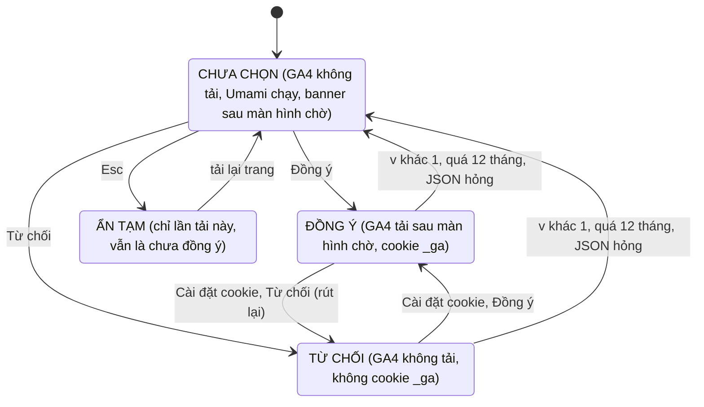

# 004: Đo lường truy cập (Umami + GA4)

> Trạng thái: Đề xuất · Cập nhật: 2026-10-15 · Liên quan: [Mục lục spec](../README.md), [plan.md](plan.md), [tasks.md](tasks.md), [Mục lục ADR](../../adr/README.md) (ADR 0007), [Lộ trình M4](../../plan/roadmap.md#m4-analytics)

Chủ quán cần biết bao nhiêu người vào web, họ đến từ đâu (Google, Maps, Facebook, Instagram, TikTok, QR tại quán) và bao nhiêu người bấm Gọi, Zalo, Messenger hay Đặt bàn. Quyết định ngày 2026-10-14 dùng hai công cụ:

- **Umami** tự cài, không cookie, không lưu IP: luôn chạy, đếm đủ mọi lượt. Hạ tầng Umami: tài liệu ở repo hạ tầng riêng (private).
- **Google Analytics 4**: chỉ tải sau khi khách bấm **Đồng ý** trên banner (Consent Mode kiểu *basic*), để xem khách mới/quay lại và hành trình. **Google Signals tắt** cho tới khi site có vài nghìn lượt mỗi tháng.

Ngoài ra, zone Cloudflare của `thehot.vn` **đang bật sẵn Cloudflare Web Analytics** (Cloudflare tự chèn beacon `static.cloudflareinsights.com` và `/cdn-cgi/rum`): thống kê không cookie và Core Web Vitals của khách thật. Phải nhắc trong `/privacy` và quyết định giữ song song hay tắt.

Hiện thực: PR A (Umami, sự kiện, `/privacy`) đang chờ review, chưa bật trên production vì chưa có Website ID ([tasks.md](tasks.md)); GA4 và banner chưa làm. Spec này chỉ mô tả phần nằm trong repo website.

## 1. Mục tiêu

| # | Câu hỏi cần trả lời | Nguồn |
|---|---|---|
| 1 | Mỗi ngày / tuần bao nhiêu người vào web? | Umami |
| 2 | Khách đến từ đâu? | Umami (referrer, UTM), GA4 |
| 3 | Trang nào được xem nhiều? | Umami, GA4 |
| 4 | Bao nhiêu lượt bấm Gọi / Zalo / Messenger / Facebook, ở vị trí nào? | Umami (đủ), GA4 (người đã đồng ý) |
| 5 | Bao nhiêu người điền xong form đặt bàn? | Umami, GA4 |
| 6 | Khách mới hay quay lại, hành trình qua nhiều lần ghé? | GA4 |
| 7 | Độ tuổi, giới tính, sở thích | GA4 + Signals khi đủ đông; trước đó dùng Meta Business Suite, Instagram, TikTok Insights |
| 8 | Người ta tìm gì trên Google mà ra web? | Search Console |
| 9 | Bao nhiêu lượt gọi, chỉ đường từ Google Maps? | Google Business Profile → Performance |

## 2. Câu chuyện người dùng

| # | Là | Tôi muốn | Để |
|---|---|---|---|
| U1 | Chủ quán | xem lượt vào, nguồn và lượt bấm liên hệ mỗi tuần | dồn sức đăng bài ở kênh mang khách về |
| U2 | Khách | dùng web bình thường dù từ chối cookie | không bị ép đồng ý |
| U3 | Khách đã đồng ý | đổi ý bất cứ lúc nào bằng một link | rút lại dễ như khi đồng ý |
| U4 | Khách | không bao giờ bị gửi tên hay số điện thoại vào công cụ thống kê | dữ liệu đặt bàn an toàn |

## 3. Giao diện

### 3.1 Banner xin đồng ý

- Hiện **sau** màn hình chờ (khi `data-splash` chuyển `exit` hoặc `done`, trễ thêm khoảng 0,9 s), dạng thanh nhỏ ở đáy, theo màu và phông của The Hot.
- Hai nút **ngang hàng, cùng nổi bật**: **Từ chối** · **Đồng ý**; kèm link *Chính sách bảo mật*.
- Không phải dialog modal: không bẫy focus, không khoá cuộn; nằm sớm trong DOM (ngay sau link "Chuyển đến nội dung") để người dùng bàn phím và trình đọc màn hình gặp trước nội dung. Esc ẩn banner cho tới lần tải trang sau (vẫn là chưa đồng ý).
- Màn hình hẹp: banner chiếm đáy, nút liên hệ nổi được nhấc lên bằng `translate` (không gây layout shift). Màn hình rộng: banner bên trái, chừa chỗ cho nút nổi bên phải.
- Không chặn thao tác: chưa chọn thì coi như chưa đồng ý.
- Footer có link **Bảo mật thông tin · Cài đặt cookie** (footer hiện chưa có link `/privacy`); `/privacy` có nút Cài đặt cookie; menu điều hướng tuỳ chọn. "Cài đặt cookie" mở lại banner và hiện lựa chọn hiện tại.
- Không có Measurement ID của GA4 lúc build, hoặc đang chạy ở tên miền khác: không banner, không nút Cài đặt cookie.

Chữ trên banner (bản nháp, chờ chủ quán duyệt):

> **COOKIE THỐNG KÊ**
>
> The Hot muốn dùng cookie Google Analytics để biết khách tìm tới web từ đâu và hay xem trang nào. Từ chối thì web vẫn dùng bình thường. Chính sách bảo mật
>
> *(khi mở lại)* Lựa chọn hiện tại: **Đồng ý** (ngày chọn)
>
> [ TỪ CHỐI ]  [ ĐỒNG Ý ]

### 3.2 Trạng thái đồng ý

Lưu ở `localStorage["thehot-consent"] = { v: 1, analytics: boolean, ads: false, at: "<ISO 8601>" }`. Đây là lưu trữ cần thiết để nhớ lựa chọn, không cần hỏi trước.

- **Rút lại**: `consent update` về denied, tắt GA trong trang (`ga-disable-<ID>`), xoá cookie `_ga`, `_ga_*` ở mọi domain cha (xoá lại một lần sau khoảng 1,5 s); lần tải sau không tải GA4. Không cần tải lại trang.
- **Đồng ý**: thứ tự lệnh `consent default` (bốn mục denied) → `consent update` (`analytics_storage: granted`) → `config` với `allow_google_signals: false`, `allow_ad_personalization_signals: false`; `ad_storage`, `ad_user_data`, `ad_personalization` giữ denied (chưa chạy quảng cáo). Rồi mới chèn `gtag.js`.
- Khách đã đồng ý từ trước: GA4 cũng chỉ tải sau màn hình chờ, để không tranh băng thông lần tải đầu.
- `localStorage` bị chặn: nhớ lựa chọn trong bộ nhớ cho lần tải trang này; tải lại thì hỏi lại; không lỗi.
- Nhiều tab: sự kiện `storage` đưa lựa chọn mới sang tab khác (tab kia tự bật hoặc tắt GA, tự ẩn banner).
- Lựa chọn hết hạn, đổi phiên bản hoặc hỏng: coi như chưa chọn, dọn cookie `_ga*` cũ.

## 4. Dữ liệu

### 4.1 Sự kiện

Lượt xem trang do Umami và GA4 tự đếm, kể cả khi chuyển trang trong Next.js. Sự kiện tự định nghĩa (tên `snake_case`, giống nhau ở Umami và GA4):

| Sự kiện | Khi nào | Thuộc tính | GA4 key event |
|---|---|---|---|
| `contact_click` | Bấm Gọi / Zalo / Messenger / Facebook | `method`: `phone` \| `zalo` \| `messenger` \| `facebook`; `location`: `floating` \| `footer` \| `nav` \| `event` \| `reservation` | Có |
| `booking_cta_click` | Bấm "Đặt bàn" / "Chốt bàn" | `location`: `hero` \| `floating` \| `nav` \| `event` \| `closing` \| `menu_top` \| `menu_bottom` \| `about` \| `not_found` | Không |
| `reservation_complete` | Form đặt bàn tới bước thành công | `party_size` (số khách 1–8) | Có |
| `menu_view_mode` | Chuyển giữa menu lật sách và danh sách (chỉ khi bấm lựa chọn chưa chọn) | `mode`: `book` \| `list` | Không |
| `menu_tab_select` | Chọn tab menu "Món ăn chơi" hoặc "Premium" (bấm hoặc phím mũi tên, Home, End; chỉ khi chọn tab chưa chọn) | `tab`: `an_choi` \| `premium`; `mode`: `book` \| `list` (đang ở sách lật hay danh sách) | Không |
| `event_view` | Mở poster sự kiện (đếm lần mở, không đếm khi lướt trong lightbox) | `event_id` (mã trong `homeEvents`) | Không |
| `social_click` | Bấm link bài viết Facebook, Instagram, TikTok | `network`: `facebook` \| `instagram` \| `tiktok` | Không |

Vị trí gắn:

| Sự kiện | Component |
|---|---|
| `contact_click` | `FloatingContact` (4 nút), `SiteFooter` (hotline, Facebook), `PersistentChrome` (Facebook trong menu), `EventTimeline` ("Ghé Facebook The Hot"), `ReservationSuccess` (Gọi, Nhắn Facebook) |
| `booking_cta_click` | `HeroIntro` → `CheersButton`, `FloatingContact`, `PersistentChrome` (`NavItem` khi trỏ tới trang đặt bàn), `EventTimeline` (từng sự kiện, khối kết), `MenuBook` (trên, dưới), `AboutClosing`, `not-found.tsx` |
| `reservation_complete` | `ReservationForm`, ngay trước khi chuyển sang bước thành công |
| `menu_view_mode` | `MenuViewSwitcher` |
| `menu_tab_select` | `MenuBook` (sách lật), `MenuList` (danh sách), qua `MenuTabs`; gọi `track()` vì phím mũi tên cũng đổi tab, `ClickTracker` chỉ nghe click |
| `event_view` | `EventTimeline` (ảnh poster, nút "Xem poster") |
| `social_click` | `EventTimeline` (lịch và bài sự kiện trên Facebook); Instagram, TikTok khi thêm link |

GA4: custom dimension phạm vi Event cho `method`, `location`, `mode`, `tab`, `event_id`, `network`; `party_size` tuỳ chọn làm custom metric.

### 4.2 Quy ước UTM

| Kênh | Link |
|---|---|
| Google Business Profile → Website | `https://thehot.vn/?utm_source=google&utm_medium=gbp` |
| Google Business Profile → Đặt chỗ | `https://thehot.vn/reservation?utm_source=google&utm_medium=gbp&utm_campaign=booking` |
| Facebook (giới thiệu trang) | `https://thehot.vn/?utm_source=facebook&utm_medium=profile` |
| Bài đăng Facebook | `https://thehot.vn/<trang>?utm_source=facebook&utm_medium=social&utm_campaign=<ten-bai-hoac-su-kien>` |
| Instagram bio | `https://thehot.vn/?utm_source=instagram&utm_medium=profile` |
| TikTok bio | `https://thehot.vn/?utm_source=tiktok&utm_medium=profile` |
| QR tại bàn / menu giấy | `https://thehot.vn/menu?utm_source=qr&utm_medium=offline&utm_campaign=ban` |

Viết thường, không dấu, `-` thay khoảng trắng.

### 4.3 Dữ liệu được và không được thu

| Thu | Không thu |
|---|---|
| Đường dẫn, query (kể cả `utm_*`), trang giới thiệu, tiêu đề trang | Tên, số điện thoại, email, ghi chú của form đặt bàn |
| Trình duyệt, hệ điều hành, loại thiết bị, màn hình, ngôn ngữ | Địa chỉ IP (Umami không lưu) |
| Quốc gia, thành phố ước tính | Cookie (Umami không đặt; GA4 chỉ sau đồng ý) |
| Tên sự kiện và thuộc tính ở mục 4.1 | Ghi lại phiên, heatmap |

## 5. API

Site không có API. Request ra ngoài: tracker và điểm nhận số liệu của Umami trên tên miền con của `thehot.vn` (URL là biến build, xem [plan.md](plan.md)); `gtag.js` và điểm nhận của Google chỉ sau khi đồng ý; beacon Cloudflare Web Analytics (do Cloudflare chèn).

## 6. Quy tắc và kiểm tra

1. **Không bao giờ** gửi tên, số điện thoại, email hay nội dung khách nhập. Không đưa dữ liệu cá nhân lên URL (query được lưu). Form đặt bàn hiện không đổi URL giữa các bước.
2. Form đặt bàn không gửi dữ liệu đi đâu; bước thành công hướng khách gọi hoặc nhắn. `reservation_complete` nghĩa là *ý định* đặt bàn; đặt thật đo bằng `contact_click` ngay sau đó.
3. GA4 chỉ nhận thuộc tính trong danh sách cho phép: `method`, `location`, `mode`, `tab`, `event_id`, `network`, `party_size`.
4. Không xếp hàng sự kiện xảy ra trước khi đồng ý để gửi sau.
5. Mọi sự kiện đi qua một hàm `track()`; analytics hỏng không được làm hỏng nút bấm.
6. Gắn sự kiện bằng thuộc tính `data-track*` và một listener chung; **không** dùng `data-umami-event` (với link mở cùng tab, tracker Umami chặn click rồi tự chuyển trang, làm trang tải lại toàn bộ và màn hình chờ chạy lại).
7. Chỉ đếm trên tên miền thật `thehot.vn` (Umami `data-domains`; GA4 kiểm hostname). Build không có biến analytics (dev, smoke test, build tay) thì không tải gì.
8. Không bật `data-exclude-search` (cần giữ `?utm_…`); bật `data-exclude-hash` (`#events` không thành lượt xem riêng).
9. Banner và `/privacy` phải mô tả đúng mọi công cụ đang chạy, gồm Cloudflare Web Analytics.

## 7. Trạng thái trống, lỗi, đang tải

| Tình huống | Người dùng thấy | Hệ thống |
|---|---|---|
| Tracker Umami chưa tải hoặc bị chặn | Không gì khác | `track()` không làm gì; sự kiện trong 1–2 s đầu có thể mất |
| Trình chặn quảng cáo chặn `gtag.js` | Không gì khác | GA thiếu dữ liệu, không lỗi JS |
| JS tắt | Trang đọc được; không banner, không nút Cài đặt cookie | Không có số liệu |
| Mở menu điều hướng khi banner đang hiện | Menu che banner | — |

## 8. Tiêu chí nghiệm thu

Loại kiểm: xem [mục lục spec, mục 4](../README.md#4-quy-ước).

| Mã | Cho (Given) | Khi (When) | Thì (Then) | Loại |
|---|---|---|---|---|
| 004-AC-01 | Build không có biến analytics | Mở trang | Không có script Umami, không banner, không request analytics | I, M |
| 004-AC-02 | Production, cửa sổ ẩn danh, chưa chọn | Chờ hết màn hình chờ; chuyển qua 3 trang | Banner hiện sau màn hình chờ; 0 request tới Google; không cookie `_ga`; Umami ghi lượt xem mỗi trang | M |
| 004-AC-03 | Như trên | Bấm Từ chối, tải lại | `thehot-consent` có `analytics: false`; banner không hiện lại; vẫn 0 request Google | M |
| 004-AC-04 | Cửa sổ ẩn danh mới | Bấm Đồng ý | Có `gtag/js`, `page_view`; cookie `_ga`; GA4 Realtime thấy 1 người | M |
| 004-AC-05 | Đã đồng ý | Footer → Cài đặt cookie → Từ chối | Khoảng 2 s sau không còn cookie `_ga*`; chuyển trang không còn request `collect`; tải lại không có `gtag/js` | M |
| 004-AC-06 | Đã đồng ý | Bấm từng nút ở bảng mục 4.1 | Umami và GA4 DebugView có đúng tên sự kiện và thuộc tính | M |
| 004-AC-07 | Điền form với tên `TestTen`, SĐT `0900000000` | Tới bước thành công; tìm hai chuỗi này trong DevTools Network | 0 kết quả trong mọi request analytics | M |
| 004-AC-08 | Đã đồng ý | `/` → `/menu` → `/about` → Back | Mỗi lần chuyển trang đúng một `page_view`, `page_title` khớp trang mới | M |
| 004-AC-09 | Mở `https://thehot.vn/?utm_source=test&utm_medium=test` | Xem Umami | Nguồn `test` được ghi | E |
| 004-AC-10 | Production | DevTools → Cookies của `thehot.vn` và tên miền con analytics | Umami không đặt cookie | M |
| 004-AC-11 | Điện thoại hẹp (375 px, 320 px) | Banner hiện | Nút Gọi / Zalo / Đặt bàn không bị che; CLS không tăng | M |
| 004-AC-12 | Bàn phím | Tab từ đầu trang | Sau link "Chuyển đến nội dung" là các nút banner; Esc ẩn; Cài đặt cookie đưa focus vào banner | M |
| 004-AC-13 | Production | PageSpeed Mobile trước và sau deploy | Không giảm điểm Performance và Accessibility | E |
| 004-AC-14 | Production | Đọc `/privacy` | Có mục Umami, mục GA4, mục Cloudflare Web Analytics; không còn câu sai về `sessionStorage` | M |

## 9. Ngoài phạm vi

- Hạ tầng Umami (máy chủ, cơ sở dữ liệu, sao lưu, giám sát, tài khoản quản trị): repo hạ tầng riêng (private).
- Google Signals, Meta Pixel, Google Ads, Consent Mode *advanced*: khi chạy quảng cáo; banner lên `v: 2` có lựa chọn "Quảng cáo được cá nhân hoá".
- Ghi lại phiên, heatmap.

## 10. Phụ thuộc

- Cần: Umami đã chạy và có Website ID (repo hạ tầng riêng); GA4 property và Measurement ID (chủ quán tạo); câu trả lời ở mục 12.
- Chặn: [003](../003-performance/spec.md) phần H (gửi Core Web Vitals về Umami).
- Liên quan: [003](../003-performance/spec.md) phần E đổi màn hình chờ, ảnh hưởng thời điểm hiện banner và mục "Tùy chọn hiển thị" của `/privacy`.

## 11. Mốc

M4 ([lộ trình](../../plan/roadmap.md#m4-analytics)).

## 12. Câu hỏi mở

Nội dung `/privacy` cần chủ quán duyệt; đây là nhận định chung, không phải tư vấn pháp lý (Luật Bảo vệ dữ liệu cá nhân 91/2025/QH15 và Nghị định 356/2025/NĐ-CP có hiệu lực từ 01/01/2026).

- [CẦN XÁC NHẬN: tài khoản Google nào làm chủ GA4 (đề xuất: tài khoản của quán, cùng tài khoản giữ Search Console và Google Business Profile)]
- [CẦN XÁC NHẬN: Data sharing settings của GA4: chỉ bật Technical support?]
- [CẦN XÁC NHẬN: giữ dữ liệu GA4 14 tháng (mức tối đa của bản miễn phí) có ổn không; Umami giữ mãi hay tự xoá sau một mốc]
- [CẦN XÁC NHẬN: xem Umami bằng tài khoản riêng chỉ xem (đề xuất) hay link chia sẻ; ngoài chủ quán còn ai cần xem]
- [CẦN XÁC NHẬN: có loại điện thoại của nhân viên/chủ quán khỏi thống kê không; wifi quán có IP tĩnh không (lọc internal traffic của GA4)]
- [CẦN XÁC NHẬN: bấm link bài viết Facebook tính là `social_click`, link trang Facebook tính là `contact_click` (đề xuất)]
- [CẦN XÁC NHẬN: thêm link Instagram, TikTok lên site không]
- [CẦN XÁC NHẬN: duyệt chữ banner và hai mục mới của `/privacy`; dùng câu "máy chủ riêng của website" thay "máy chủ của The Hot"]
- [CẦN XÁC NHẬN: ai nhận yêu cầu về dữ liệu cá nhân (hotline, Facebook, hay cần email riêng ghi trong `/privacy`); có muốn hỏi luật sư không]
- [CẦN XÁC NHẬN: có muốn nút Cài đặt cookie trong menu điều hướng; có muốn property GA4 riêng để test]
- [CẦN XÁC NHẬN: giữ Cloudflare Web Analytics song song với Umami hay tắt]
- [CẦN XÁC NHẬN: dự kiến khi nào chạy quảng cáo hoặc bật Google Signals]

## Lịch sử thay đổi

| Ngày | Thay đổi |
|---|---|
| 2026-10-14 | Tạo từ ghi chú kế hoạch analytics (chỉ phần website; phần hạ tầng chuyển sang repo hạ tầng riêng); trạng thái Đề xuất |
| 2026-10-15 | Thêm sự kiện `menu_tab_select` và thuộc tính `tab` cho hai tab menu "Món ăn chơi" / "Premium" |
