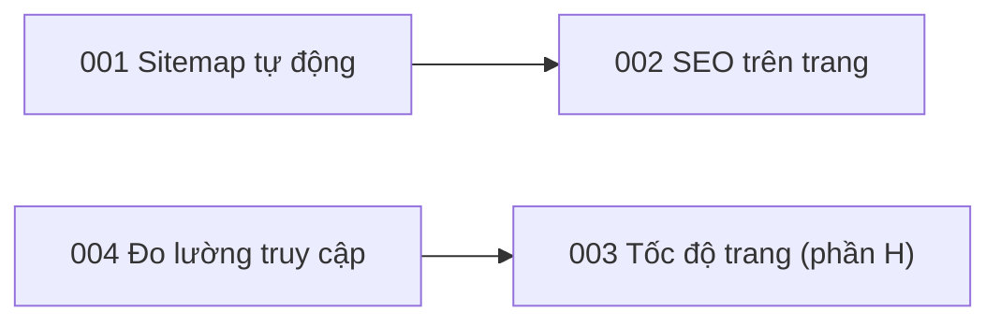

# Đặc tả tính năng

> Trạng thái: Đang áp dụng · Cập nhật: 2026-10-14 · Liên quan: [Bản đồ tài liệu](../README.md), [Lộ trình](../plan/roadmap.md), [Việc sắp làm](../plan/tasks.md), [Tiến độ](../plan/progress.md), [Mục lục ADR](../adr/README.md)

Mỗi tính năng (hoặc thay đổi đáng kể) của https://thehot.vn là một thư mục `NNN-<name>/` gồm:

| File | Trả lời | Tạo khi |
|---|---|---|
| `spec.md` | Làm gì, cho ai, xong khi nào (tiêu chí nghiệm thu) | Trước khi làm, để thống nhất phạm vi |
| `plan.md` | Làm thế nào về kỹ thuật, theo thứ tự nào, rủi ro gì | Khi mốc chứa spec bắt đầu |
| `tasks.md` | Việc nhỏ có thể tick, mỗi việc gắn với tiêu chí nghiệm thu | Cùng lúc với plan.md |

## 1. Mục lục

Cột Tài liệu là trạng thái của spec; trạng thái hiện thực chỉ ghi ở [tiến độ](../plan/progress.md#theo-spec).

| # | Tính năng | Tóm tắt | Mốc | Tài liệu | ADR |
|---|---|---|---|---|---|
| [001](001-sitemap-automation/spec.md) | Sitemap tự động | Một file cấu hình trang, kiểm lệch trong CI, `lastmod` từ git, sitemap ảnh | M1 | Đang áp dụng | 0004 |
| [002](002-onpage-seo/spec.md) | SEO trên trang | Tiêu đề, mô tả, ảnh chia sẻ (xong); JSON-LD, alt, ảnh chia sẻ riêng, chữ giới thiệu và hỏi đáp | M1, M2 | Đang áp dụng | 0005 |
| [003](003-performance/spec.md) | Tốc độ trang | Mục tiêu Core Web Vitals; ưu tiên LCP và logo (xong); video hero, cache, ảnh, màn hình chờ, font | M1, M3 | Đang áp dụng | 0006, 0008 |
| [004](004-analytics/spec.md) | Đo lường truy cập | Umami luôn chạy, GA4 sau đồng ý, banner, sự kiện, UTM | M4 | Đề xuất | 0007 |

Số ADR tra ở [mục lục ADR](../adr/README.md).

Quy ước trạng thái tài liệu trong thư mục này: **Đề xuất** khi hướng đã chốt nhưng còn câu hỏi chặn và chưa làm; **Đang áp dụng** khi ít nhất một phần đã chạy trên production và tài liệu mô tả đúng sự thật hiện tại (phần chưa làm ghi rõ trong spec).

## 2. Khi nào cần spec

| Cần spec | Không cần spec |
|---|---|
| Hành vi mới mà khách hoặc công cụ tìm kiếm thấy | Sửa lỗi nhỏ không đổi hành vi đã đặc tả |
| Thay đổi chạm nhiều thành phần, CI hoặc dữ liệu | Refactor nội bộ |
| Việc cần nhiều hơn khoảng một ngày làm | Việc vận hành một lần (ghi vào runbook hoặc tasks) |

Việc của chủ quán trên các nền tảng ngoài (Google Business Profile, trang trích dẫn, đánh giá) không có spec; chúng nằm ở [lộ trình](../plan/roadmap.md) (M5, M6) và [việc sắp làm](../plan/tasks.md).

## 3. Cách tạo một spec

1. Chép mẫu `template/docs/specs/000-template/` của docs-template thành `NNN-<name>/` (số tiếp theo, 3 chữ số; tên tiếng Anh kebab-case, ví dụ `005-events-page`).
2. Viết `spec.md` trước, trạng thái `Nháp`; xoá dòng `<!-- check-links: template -->`; thay mọi placeholder.
3. Khi mốc bắt đầu: viết `plan.md` và `tasks.md`.
4. Thêm một dòng vào bảng mục 1 và vào bảng "Theo spec" ở [tiến độ](../plan/progress.md#theo-spec).

## 4. Quy ước

- **Không định nghĩa lại dữ liệu.** Site không có cơ sở dữ liệu hay API. Thông tin quán (giờ, địa chỉ, hotline, mạng xã hội) lấy nguyên văn từ `src/components/sites/nokto/site.ts`; trang của sitemap từ `seo/sitemap-pages.json`; tiêu đề và mô tả từ `src/seo/page-meta.ts`. Spec cần thông tin mới thì ghi "Đề xuất" và thêm vào đúng file đó khi chốt.
- **Không đoán thông tin của quán.** Chưa biết thì ghi `[CẦN XÁC NHẬN: …]` kèm "chưa xác định, cần chủ quán xác nhận".
- **Tiêu chí nghiệm thu kiểm được:** mỗi dòng có đầu vào cụ thể, hành động, kết quả đo được và loại kiểm. Mã dạng `NNN-AC-01`; việc dạng `NNN-T01`.
- **Loại kiểm** (ký hiệu riêng của thư mục này):

  | Ký hiệu | Nghĩa |
  |---|---|
  | `S` | Kiểm tĩnh tự động trong CI: lint, typecheck, `npm run check:sitemap`, build |
  | `I` | Smoke test trên image vừa build (`ci/smoke-test.sh`, chạy ở mọi build Jenkins) |
  | `E` | Kiểm từ bên ngoài trên production: `curl`, Search Console, PageSpeed, Rich Results Test, Facebook Sharing Debugger |
  | `M` | Kiểm tay: trình duyệt, DevTools, điện thoại thật, bản clone tạm |

- **Công khai được:** repo này công khai. Không bí mật, không IP, không cổng hay đường dẫn nội bộ của máy chủ; chi tiết hạ tầng nằm ở repo hạ tầng riêng (private).

## 5. Phụ thuộc giữa các spec

Đọc "A --> B" là "B cần A".

- 002 dùng quy ước ảnh thật và ảnh mới của 001 cho `Restaurant.image` và ảnh chia sẻ riêng.
- 003 phần H gửi Core Web Vitals về Umami của 004.
- 003 phần E (màn hình chờ) ảnh hưởng thời điểm hiện banner của 004 và nội dung `/privacy`.
